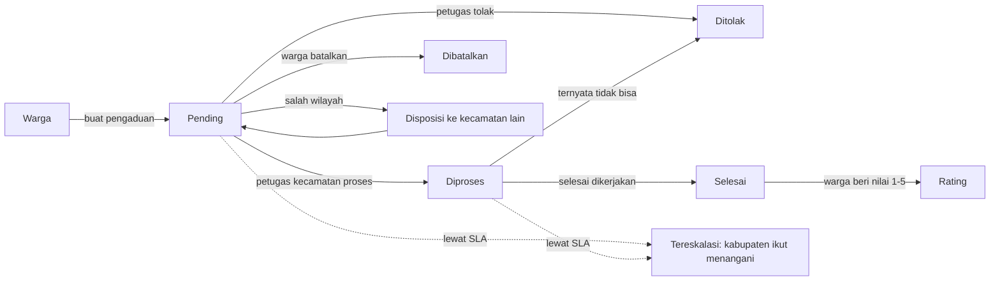

# 1. Gambaran Umum

## 1.1 WADULIN itu apa?

WADULIN (Wadah Aduan Digital) adalah aplikasi web untuk **pengaduan masyarakat Kabupaten Jember**. Bayangkan ada jalan berlubang di depan rumahmu. Tanpa aplikasi, kamu harus datang ke kantor kecamatan, mengisi formulir, lalu tidak tahu kapan ditindaklanjuti. Dengan WADULIN:

1. Warga melapor dari ponsel: pilih jenis masalah, tandai lokasi di peta, unggah foto.
2. Warga langsung mendapat **kode tiket**, misalnya `WDL-2026-000123`.
3. Pengaduan masuk ke **antrian petugas kecamatan** tempat masalah itu berada.
4. Petugas wajib menindaklanjuti dalam **batas waktu (SLA)**, bawaannya 3 hari kerja.
5. Kalau petugas terlambat, pengaduan otomatis **dieskalasi** (dinaikkan) ke petugas kabupaten.
6. Warga bisa memantau perkembangannya kapan saja, dan memberi penilaian setelah selesai.

## 1.2 Siapa saja penggunanya?

Ada **empat jenis pengunjung**. Tiga di antaranya punya akun dengan **peran (role)** yang berbeda. Peran disimpan di kolom `users.role` dan didefinisikan di `app/Enums/UserRole.php`.

| Pengguna | Nilai `role` di database | Bisa apa | Halaman utamanya |
| --- | --- | --- | --- |
| Pengunjung tanpa akun | (tidak login) | Lihat beranda, lacak tiket, peta, pengumuman, FAQ | `/` |
| Warga | `masyarakat` | Semua di atas + buat, batalkan, dan nilai pengaduan miliknya | `/dashboard` |
| Petugas kecamatan | `admin_kecamatan` | Kelola pengaduan **di kecamatannya saja** | `/kecamatan` |
| Petugas kabupaten | `admin_kabupaten` | Pantau **semua kecamatan**, tangani yang tereskalasi, kelola data master | `/kabupaten` |

> **Kenapa petugas kecamatan hanya melihat kecamatannya?** Karena di dunia nyata, petugas Kecamatan Patrang tidak bertanggung jawab atas jalan di Kecamatan Ambulu. Membatasi tampilan mencegah kebingungan dan menjaga data warga hanya dilihat pihak yang perlu.

## 1.3 Istilah penting

Istilah ini muncul terus di kode dan dokumentasi. Hafalkan dulu.

| Istilah | Nama di kode | Arti |
| --- | --- | --- |
| Pengaduan | `Complaint` | Satu laporan dari warga |
| Kode tiket | `ticket_code` | ID publik pengaduan, format `WDL-{tahun}-{6 digit}` |
| Kategori | `Category` | Jenis masalah: Jalan & Jembatan, Sampah, dll. |
| Kecamatan | `District` | Wilayah. Jember punya 31 kecamatan. |
| Status | `ComplaintStatus` | Tahap pengaduan: Pending, Diproses, Selesai, Ditolak, Dibatalkan |
| SLA | `due_at` | *Service Level Agreement*: batas waktu tindak lanjut |
| Eskalasi | `escalated_at` | Pengaduan yang lewat SLA "dinaikkan" agar dipantau kabupaten |
| Disposisi | `ComplaintDisposition` | Memindahkan pengaduan ke kecamatan lain karena salah wilayah |
| Riwayat status | `ComplaintStatusHistory` | Catatan setiap perubahan status (jejak audit) |
| Lampiran | `ComplaintAttachment` | Foto. Jenisnya `bukti` (dari warga) atau `hasil` (dari petugas) |
| Titik QR | `QrLocation` | Lokasi fasilitas umum yang ditempeli kode QR untuk melapor cepat |
| Pengumuman | `Announcement` | Berita resmi dari Pemkab |
| Petugas | `officer` | User dengan role admin kecamatan atau kabupaten |

> **Kenapa nama di kode memakai bahasa Inggris, tapi URL dan tampilan memakai bahasa Indonesia?** Konvensi Laravel dan PHP (nama class, method, tabel) berbahasa Inggris, jadi kode lebih mudah dibaca developer mana pun dan cocok dengan dokumentasi Laravel. Sedangkan URL (`/pengaduan/buat`) dan teks layar ditujukan untuk warga Jember, jadi memakai bahasa Indonesia.

## 1.4 Teknologi yang dipakai

| Teknologi | Versi | Dipakai untuk | Kenapa dipilih |
| --- | --- | --- | --- |
| PHP | 8.3+ | Bahasa backend | Wajib untuk Laravel 13 |
| Laravel | 13 | Framework web: routing, database, validasi, auth | Lengkap, dokumentasinya bagus, umum dipakai di Indonesia |
| SQLite | bawaan | Database saat development dan tes | Tidak perlu install server database. Bisa diganti MySQL tanpa ubah kode. |
| Blade | bawaan Laravel | Template HTML | Sederhana, render di server, tidak perlu framework JS |
| Tailwind CSS | 4 | Styling | Cepat membuat UI konsisten lewat class utilitas |
| Vite | 8 | Membangun (build) file CSS/JS | Bawaan Laravel |
| Leaflet + OpenStreetMap | 1.9.4 | Peta interaktif | Gratis, tanpa API key (beda dengan Google Maps) |
| qrcodejs | 1.0.0 | Membuat gambar QR di browser | Kecil, tidak perlu library PHP tambahan |
| PHPUnit | 12 | Testing otomatis | Bawaan Laravel |
| Laravel Pint | 1.x | Merapikan format kode PHP | Supaya gaya penulisan seragam |

> **Kenapa tidak pakai React/Vue?** Aplikasi ini sebagian besar berupa formulir dan daftar. Halaman yang di-render server (Blade) lebih sederhana, lebih cepat dibuka di ponsel murah, dan lebih mudah dipelajari. JavaScript hanya dipakai di tempat yang benar-benar butuh: peta dan QR.

## 1.5 Struktur folder

Hanya folder yang penting untuk proyek ini yang dijelaskan. Sisanya bawaan Laravel.

```
Wadulin/
├── app/
│   ├── Enums/                 ← Daftar nilai tetap (status, role, jenis lampiran)
│   │   ├── AttachmentType.php
│   │   ├── ComplaintStatus.php    ← ★ aturan transisi status ada di sini
│   │   └── UserRole.php
│   ├── Http/
│   │   ├── Controllers/       ← Menerima request, memanggil model, mengembalikan view
│   │   │   ├── Admin/         ← Controller panel petugas (kecamatan & kabupaten)
│   │   │   ├── Auth/          ← Daftar, masuk, keluar
│   │   │   └── *.php          ← Controller publik dan warga
│   │   ├── Middleware/
│   │   │   └── EnsureUserHasRole.php  ← Penjaga "hanya role X yang boleh masuk"
│   │   └── Requests/          ← Form Request: validasi input + cek izin
│   ├── Models/                ← Representasi tabel database + logika bisnis
│   │   └── Complaint.php          ← ★ model paling penting
│   ├── Notifications/
│   │   └── ComplaintUpdated.php   ← Notifikasi ke warga
│   └── Policies/              ← Aturan "siapa boleh melakukan apa pada data apa"
├── bootstrap/app.php          ← Registrasi middleware alias 'role' dan redirect
├── config/wadulin.php         ← Konfigurasi khusus aplikasi (jumlah hari SLA)
├── database/
│   ├── factories/             ← Pembuat data palsu untuk tes dan seeder
│   ├── migrations/            ← Definisi struktur tabel
│   └── seeders/               ← Pengisi data awal/demo
├── resources/
│   ├── css/app.css            ← Token warna + komponen CSS (btn, panel, field-input)
│   └── views/                 ← Template Blade (HTML)
│       ├── layouts/           ← Kerangka halaman: app (publik) & admin (panel)
│       ├── components/        ← Potongan UI yang dipakai ulang (badge status, dll.)
│       ├── admin/             ← Halaman panel petugas
│       ├── complaints/        ← Halaman pengaduan milik warga
│       └── ...                ← Halaman publik
├── routes/
│   ├── web.php                ← ★ semua URL aplikasi didaftarkan di sini
│   └── console.php            ← Perintah artisan & jadwal (eskalasi otomatis)
├── tests/Feature/             ← Tes otomatis
└── docs/                      ← Dokumentasi ini
```

> **Tips:** Kalau ingin tahu "fitur X kodenya di mana", mulai dari `routes/web.php`. Setiap URL menunjuk ke satu controller. Dari controller, kamu bisa mengikuti ke Form Request, Policy, Model, dan View.

## 1.6 Gambaran alur besar

Diagram ini menunjukkan perjalanan satu pengaduan dari dibuat sampai selesai. Detailnya ada di [bab 4](04-status-sla-eskalasi.md).



Lanjut ke [bab 2: Cara kerja request di Laravel](02-alur-request-laravel.md).
