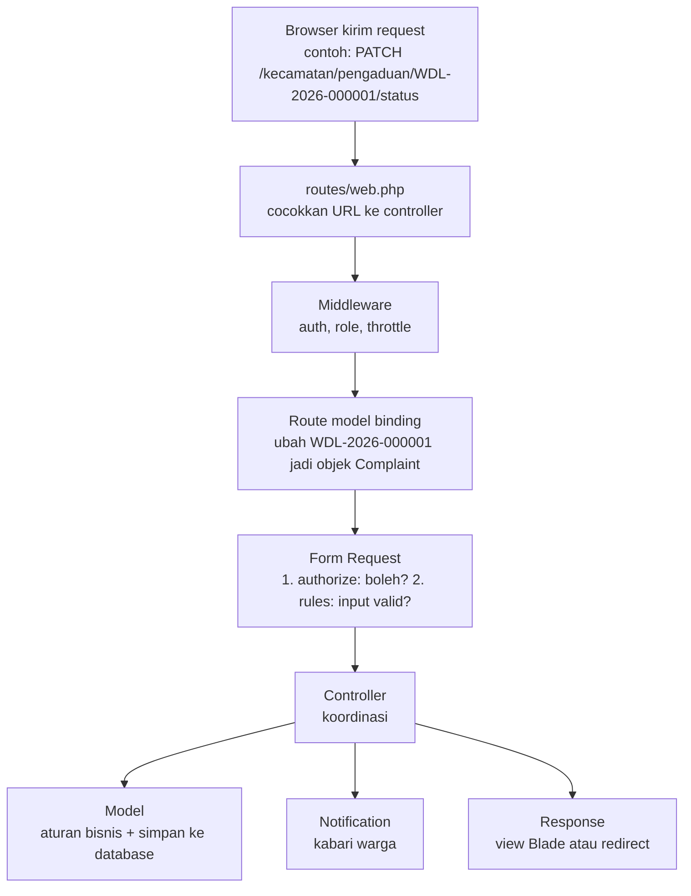

# 2. Cara Kerja Request di Laravel

Bab ini menjelaskan **jalan yang dilewati setiap request** di aplikasi ini. Kalau kamu paham bab ini, kamu bisa membaca fitur mana pun dengan cara yang sama.

## 2.1 Peta besarnya

Setiap kali browser membuka URL atau mengirim formulir, Laravel memproses request melewati lapisan-lapisan ini, berurutan:



Setiap lapisan punya **satu tugas**. Ini disebut *separation of concerns* (pemisahan tanggung jawab). Keuntungannya: kalau ada bug validasi, kamu tahu harus melihat Form Request; kalau ada bug hak akses, lihat Policy; dan seterusnya.

| Lapisan | Pertanyaan yang dijawab | Lokasi di proyek |
| --- | --- | --- |
| Route | "URL ini ditangani siapa?" | `routes/web.php` |
| Middleware | "Sudah login? Perannya cocok? Terlalu sering request?" | `app/Http/Middleware/`, alias di `bootstrap/app.php` |
| Route model binding | "Data mana yang dimaksud URL ini?" | `getRouteKeyName()` di model |
| Form Request | "Orang ini boleh melakukan aksi ini? Inputnya benar?" | `app/Http/Requests/` |
| Policy | "Aturan izinnya apa?" (dipanggil oleh Form Request atau controller) | `app/Policies/` |
| Controller | "Langkah apa saja yang harus dijalankan?" | `app/Http/Controllers/` |
| Model | "Bagaimana aturan bisnis dan penyimpanan datanya?" | `app/Models/` |
| View | "Bagaimana hasilnya ditampilkan?" | `resources/views/` |

## 2.2 Contoh nyata: petugas mengubah status pengaduan

Kita ikuti satu aksi dari awal sampai akhir: **petugas Kecamatan Patrang menekan tombol "Proses" pada pengaduan `WDL-2026-000001`**.

### Langkah 1 — Browser mengirim formulir

Di halaman detail pengaduan admin (`resources/views/admin/complaints/show.blade.php`), ada formulir:

```blade
<form method="POST" action="{{ route($panel.'.pengaduan.status', $complaint) }}" enctype="multipart/form-data">
    @csrf
    @method('PATCH')
    <input type="radio" name="status" value="diproses">
    <textarea name="note"></textarea>
    ...
</form>
```

Hal yang perlu diperhatikan:

- `route('kecamatan.pengaduan.status', $complaint)` membuat URL dari **nama route**, bukan menulis URL manual. Jadi kalau URL-nya diubah di `routes/web.php`, semua link ikut berubah otomatis.
- `@csrf` menambahkan token rahasia. Laravel menolak formulir POST tanpa token ini (perlindungan dari serangan CSRF, dibahas di [bab 8](08-keamanan-hak-akses.md)).
- `@method('PATCH')` karena HTML hanya mengenal GET dan POST. Laravel membaca field tersembunyi `_method` dan memperlakukannya sebagai PATCH.
- `enctype="multipart/form-data"` wajib ada kalau formulir mengirim file (foto hasil).

### Langkah 2 — Route mencocokkan URL

Di `routes/web.php:67-81`:

```php
$adminComplaintRoutes = function (): void {
    // ...
    Route::patch('/pengaduan/{complaint}/status', ComplaintStatusController::class)->name('pengaduan.status');
    // ...
};

Route::middleware(['auth', 'role:admin_kecamatan'])
    ->prefix('kecamatan')
    ->name('kecamatan.')
    ->group($adminComplaintRoutes);
```

Artinya:

- URL lengkapnya `PATCH /kecamatan/pengaduan/{complaint}/status`, karena ada `prefix('kecamatan')`.
- Nama lengkapnya `kecamatan.pengaduan.status`, karena ada `name('kecamatan.')`.
- Sebelum masuk controller, request harus lolos middleware `auth` dan `role:admin_kecamatan`.

> **Kenapa route admin ditulis dalam variabel `$adminComplaintRoutes`?** Karena petugas kecamatan dan kabupaten memakai halaman pengaduan yang **sama persis**, hanya beda awalan URL (`/kecamatan/...` vs `/kabupaten/...`) dan beda middleware. Daripada menulis daftar route dua kali, daftar itu disimpan di satu closure lalu dipanggil di dua grup (baris 78-87). Kalau ada route admin baru, cukup ditambah di satu tempat.

### Langkah 3 — Middleware memeriksa

Middleware berjalan berurutan:

1. **`auth`** (bawaan Laravel): kalau belum login, alihkan ke `/login`.
2. **`role:admin_kecamatan`**: kode kita sendiri di `app/Http/Middleware/EnsureUserHasRole.php:19`.

```php
public function handle(Request $request, Closure $next, string ...$roles): Response
{
    $user = $request->user();
    $allowedRoles = array_map(fn (string $role): UserRole => UserRole::from($role), $roles);

    if ($user === null || ! in_array($user->role, $allowedRoles, true)) {
        abort(403, 'Anda tidak memiliki akses ke halaman ini.');
    }

    return $next($request);
}
```

- Teks setelah titik dua (`admin_kecamatan`) masuk ke parameter `...$roles`. Bisa lebih dari satu: `role:admin_kecamatan,admin_kabupaten`.
- `UserRole::from('admin_kecamatan')` mengubah teks menjadi enum. Kalau ada salah ketik, misalnya `role:admin_kecamtan`, langsung error. Ini disengaja supaya salah ketik ketahuan saat development, bukan diam-diam membuka akses.
- `abort(403)` menghentikan request dan menampilkan halaman "Forbidden".
- `$next($request)` artinya "lanjut ke lapisan berikutnya".

Alias `role` didaftarkan di `bootstrap/app.php`:

```php
$middleware->alias([
    'role' => EnsureUserHasRole::class,
]);
```

### Langkah 4 — Route model binding

Parameter URL `{complaint}` berisi teks `WDL-2026-000001`. Controller menerima parameter bertipe `Complaint $complaint`. Laravel otomatis mencari data di database. Ini disebut **route model binding**.

Secara bawaan Laravel mencari berdasarkan kolom `id`. Tapi model `Complaint` mengubahnya di `app/Models/Complaint.php:60`:

```php
public function getRouteKeyName(): string
{
    return 'ticket_code';
}
```

Jadi Laravel menjalankan kira-kira `Complaint::where('ticket_code', 'WDL-2026-000001')->firstOrFail()`. Kalau tidak ketemu, otomatis halaman 404.

> **Kenapa memakai kode tiket di URL, bukan `id`?**
> 1. **Privasi dan keamanan.** Kalau URL-nya `/pengaduan/5`, orang bisa menebak bahwa ada pengaduan 1 sampai 4, lalu mencoba membukanya. Ini disebut *enumeration*. Policy tetap mencegahnya, tapi lebih baik tidak memberi petunjuk.
> 2. **Mudah dikomunikasikan.** Warga, petugas, dan URL memakai kode yang sama. Petugas bisa bilang "cek tiket WDL-2026-000123" dan langsung cocok dengan URL.

Contoh lain di proyek ini: `Announcement` memakai `slug` (`/pengumuman/wadulin-resmi-diluncurkan`), dan route QR memakai `{qrLocation:code}` (`routes/web.php:35`). Bentuk `{param:kolom}` adalah cara menentukan kolom langsung di route, tanpa mengubah model.

### Langkah 5 — Form Request: izin dan validasi

Controller menerima `UpdateComplaintStatusRequest $request`. Sebelum isi controller dijalankan, Laravel otomatis menjalankan dua method di `app/Http/Requests/UpdateComplaintStatusRequest.php`:

**a. `authorize()`: bolehkah user ini?**

```php
public function authorize(): bool
{
    return $this->user()?->can('updateStatus', $this->complaint()) ?? false;
}
```

`can('updateStatus', $complaint)` memanggil method `updateStatus` di `app/Policies/ComplaintPolicy.php:29`. Kalau hasilnya `false`, Laravel langsung mengembalikan **403** dan controller tidak pernah dijalankan.

> **Bagaimana Laravel tahu `ComplaintPolicy` milik `Complaint`?** Lewat *policy auto-discovery*: model `App\Models\Complaint` otomatis dipasangkan dengan `App\Policies\ComplaintPolicy` karena namanya cocok. Tidak perlu didaftarkan manual.

**b. `rules()`: inputnya valid?**

```php
public function rules(): array
{
    $allowedStatuses = array_map(
        fn (ComplaintStatus $status): string => $status->value,
        $this->complaint()->status->officerTransitions(),
    );

    return [
        'status' => ['required', Rule::in($allowedStatuses)],
        'note' => [
            Rule::requiredIf($this->input('status') === ComplaintStatus::Ditolak->value),
            'nullable', 'string', 'min:10', 'max:2000',
        ],
        'is_public' => ['sometimes', 'boolean'],
        'photos' => ['nullable', 'array', 'max:3'],
        'photos.*' => ['image', 'mimes:jpg,jpeg,png,webp', 'max:2048'],
    ];
}
```

Perhatikan aturan `status`: daftar status yang diizinkan **dihitung dari status saat ini**. Kalau pengaduan masih Pending, hanya `diproses` dan `ditolak` yang lolos. Kalau ada yang mengirim `selesai` langsung (misalnya lewat alat developer browser), validasi gagal.

Kalau validasi gagal, Laravel otomatis kembali ke halaman sebelumnya dengan pesan error (`$errors` di Blade) dan isian lama (`old('note')`). Pesan error berbahasa Indonesia diatur di method `messages()`.

> **Kenapa validasi ditaruh di Form Request, bukan di controller?** Controller jadi pendek dan fokus pada alur. Validasi juga bisa dipakai ulang dan dites terpisah. Di proyek ini, **semua** aksi yang menerima input memakai Form Request. Ikuti pola ini.

### Langkah 6 — Controller mengoordinasi

Setelah lolos semua pemeriksaan, `app/Http/Controllers/Admin/ComplaintStatusController.php:16` dijalankan:

```php
public function __invoke(UpdateComplaintStatusRequest $request, Complaint $complaint): RedirectResponse
{
    $target = ComplaintStatus::from($request->validated('status'));
    $user = $request->user();

    DB::transaction(function () use ($request, $complaint, $target, $user): void {
        $complaint->transitionTo($target, $user, $request->validated('note'), $request->boolean('is_public', true));

        foreach ($request->file('photos', []) as $photo) {
            $complaint->attachments()->create([ /* simpan foto hasil */ ]);
        }
    });

    $complaint->user->notify(new ComplaintUpdated($complaint, "Status pengaduan kamu kini {$target->label()}..."));

    return back()->with('success', "Status pengaduan {$complaint->ticket_code} diubah menjadi {$target->label()}.");
}
```

Hal penting:

- **`__invoke`**: controller ini hanya punya satu aksi, jadi memakai *single action controller*. Di route cukup ditulis `ComplaintStatusController::class` tanpa nama method. Pola ini dipakai untuk aksi yang berdiri sendiri (ubah status, disposisi, batal, nilai).
- **`$request->validated('status')`**: hanya mengambil data yang **sudah lolos validasi**. Jangan pakai `$request->input()` untuk data yang akan disimpan, karena bisa berisi field yang tidak divalidasi.
- **`DB::transaction`**: ubah status dan simpan foto dijalankan sebagai satu kesatuan. Kalau penyimpanan foto gagal di tengah jalan, perubahan status ikut dibatalkan (*rollback*). Tanpa transaksi, bisa terjadi status berubah tapi foto hilang.
- **Logika bisnis ada di model** (`transitionTo`), bukan di controller. Controller hanya "memanggil". Dengan begitu aturan transisi status cukup ditulis sekali dan dipakai di mana saja.
- **`back()->with('success', ...)`**: kembali ke halaman sebelumnya sambil membawa pesan sekali tampil (*flash message*). Layout menampilkannya lewat `session('success')`.

### Langkah 7 — Model menjalankan aturan bisnis

`transitionTo()` di `app/Models/Complaint.php:178` memeriksa sekali lagi apakah transisi diizinkan, lalu memanggil `recordStatusChange()` (`:202`) yang:

1. Mengingat status lama.
2. Mengubah status.
3. Kalau status baru adalah status akhir (Selesai/Ditolak/Dibatalkan), mengisi `resolved_at` dan menghapus tanda eskalasi.
4. Menyimpan pengaduan.
5. Menulis baris baru di `complaint_status_histories` (jejak audit).

Semua dibungkus `DB::transaction`. Detail lengkapnya di [bab 4](04-status-sla-eskalasi.md).

> **Kenapa aturan transisi dicek dua kali (di Form Request dan di model)?** Form Request memberi pesan error yang ramah untuk pengguna. Pemeriksaan di model adalah **pengaman terakhir**: kalau suatu saat ada developer yang memanggil `transitionTo()` dari tempat lain (misalnya perintah artisan) tanpa Form Request, aturan tetap dijaga. Model melempar `InvalidArgumentException` karena itu berarti ada bug di kode, bukan kesalahan input pengguna.

### Langkah 8 — Notifikasi dan respons

`$complaint->user->notify(...)` menyimpan notifikasi ke tabel `notifications` untuk warga pemilik pengaduan. Warga melihatnya di dashboard ([bab 6](06-fitur-warga.md#69-notifikasi)).

Terakhir, browser diarahkan kembali ke halaman detail dan melihat pesan hijau "Status pengaduan ... diubah menjadi Diproses."

## 2.3 Ringkasan pola yang wajib diikuti

Saat menambah fitur baru, tiru pola yang sudah ada:

1. **Daftarkan route bernama** di `routes/web.php`, di dalam grup middleware yang tepat.
2. **Buat Form Request** untuk setiap aksi yang menerima input. Isi `authorize()` (pakai Policy kalau aturannya bergantung pada data) dan `rules()`. Tulis pesan error dalam bahasa Indonesia.
3. **Controller tipis**: ambil data tervalidasi, panggil method model, kembalikan view atau redirect.
4. **Aturan bisnis di model** (atau enum), bukan di controller atau view.
5. **Pakai `DB::transaction`** kalau satu aksi menulis ke lebih dari satu tabel.
6. **Tulis tes** di `tests/Feature/` ([bab 10](10-testing.md)).

Lanjut ke [bab 3: Database dan model](03-database-dan-model.md).
