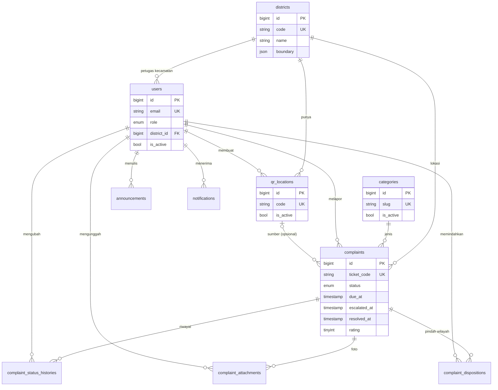

# 3. Database dan Model

Bab ini menjelaskan **semua tabel milik aplikasi**, kolom-kolomnya, hubungan antartabel, dan alasan di balik setiap keputusan desain.

## 3.1 Konsep dasar (kalau kamu baru belajar)

- **Migration** (`database/migrations/`) adalah file PHP yang mendefinisikan struktur tabel. Menjalankan `php artisan migrate` membuat tabel sesuai isi file migration. Keuntungannya: struktur database ikut tersimpan di Git, jadi semua developer punya tabel yang sama.
- **Model** (`app/Models/`) adalah class PHP yang mewakili satu tabel. Satu objek model = satu baris tabel. Model `Complaint` ↔ tabel `complaints`.
- **Relasi** adalah method di model yang menghubungkan tabel lewat *foreign key*. Contoh: `$complaint->user` mengambil warga pemilik pengaduan.
- **Cast** mengubah nilai mentah dari database menjadi tipe PHP yang lebih berguna. Contoh: kolom `status` berisi teks `'pending'`, tapi di PHP menjadi enum `ComplaintStatus::Pending`.

## 3.2 Diagram relasi (ERD)



> Kamu juga bisa melihat struktur lengkap dalam bentuk SQL di file `wadulin_erd.sql` di root proyek.

## 3.3 Tabel per tabel

### `districts` — kecamatan

Migration: `database/migrations/2026_11_17_151837_create_districts_table.php` · Model: `app/Models/District.php`

| Kolom | Tipe | Keterangan |
| --- | --- | --- |
| `id` | bigint | Primary key |
| `code` | string(10), unik | Kode internal, contoh `JBR-18` |
| `name` | string(100) | Nama kecamatan, contoh `Patrang` |
| `boundary` | json, boleh kosong | Disiapkan untuk menyimpan batas wilayah (poligon peta). **Belum dipakai.** |

Relasi di model: `complaints()`, `officers()` (user petugas di kecamatan ini), `qrLocations()`.

Data diisi oleh `database/seeders/DistrictSeeder.php` (31 kecamatan Jember). Seeder memakai `updateOrCreate` supaya bisa dijalankan berkali-kali tanpa membuat data ganda.

### `users` — semua akun

Migration: `0001_01_01_000000_create_users_table.php` dan `2026_11_17_151839_add_wadulin_columns_to_users_table.php` · Model: `app/Models/User.php`

| Kolom | Tipe | Keterangan |
| --- | --- | --- |
| `name`, `email`, `password` | | Standar Laravel. `email` unik. `password` otomatis di-*hash* lewat cast `'password' => 'hashed'`. |
| `phone` | string(20) | Wajib. Supaya petugas bisa menghubungi pelapor. |
| `address`, `avatar_path` | boleh kosong | Disiapkan, **belum dipakai** di tampilan. |
| `role` | enum | `masyarakat`, `admin_kecamatan`, `admin_kabupaten`. Di PHP menjadi enum `UserRole`. |
| `district_id` | FK → districts, boleh kosong | **Hanya diisi untuk admin kecamatan.** Warga dan admin kabupaten bernilai `null`. |
| `is_active` | boolean | Akun nonaktif tidak bisa login. |
| `last_login_at` | timestamp | Diisi saat login berhasil. |

> **Kenapa semua peran disimpan di satu tabel `users`, bukan tabel terpisah per peran?** Karena semua peran login dengan cara yang sama (email + kata sandi). Satu tabel membuat sistem login Laravel bisa dipakai apa adanya. Perbedaan peran cukup ditandai kolom `role`.

> **Kenapa petugas tidak dihapus, hanya dinonaktifkan (`is_active`)?** Karena nama petugas tercatat di riwayat status dan disposisi. Kalau akunnya dihapus, jejak audit "siapa mengubah apa" hilang. Foreign key juga memakai `restrictOnDelete`, jadi database sendiri akan menolak penghapusan user yang punya riwayat.

Method bantu di model: `hasRole()`, `isAdminKecamatan()`, `isAdminKabupaten()`. Pakai method ini daripada membandingkan string manual.

### `categories` — jenis pengaduan

Migration: `2026_11_17_151840_create_categories_table.php` · Model: `app/Models/Category.php`

| Kolom | Keterangan |
| --- | --- |
| `name` | Nama tampil, contoh "Jalan & Jembatan" |
| `slug` | Versi URL dari nama (`jalan-jembatan`), **unik**. Dipakai untuk mencegah kategori bernama sama. |
| `icon` | Nama ikon Lucide (disimpan, belum ditampilkan) |
| `description` | Penjelasan singkat, tampil di form pengaduan |
| `is_active` | Kategori nonaktif tidak muncul di form warga |

Scope: `Category::active()` → hanya kategori aktif.

> **Kenapa kategori tidak bisa dihapus?** Pengaduan lama masih menunjuk ke kategori itu. Menghapusnya akan merusak data lama. Jadi kategori cukup dinonaktifkan.

### `complaints` — pengaduan (tabel utama)

Migration: `2026_11_17_151843_create_complaints_table.php` · Model: `app/Models/Complaint.php`

| Kolom | Tipe | Keterangan |
| --- | --- | --- |
| `ticket_code` | string(20), unik | Kode publik `WDL-2026-000001`. Dipakai di URL. |
| `user_id` | FK → users | Pelapor |
| `category_id` | FK → categories | Jenis masalah |
| `district_id` | FK → districts | Kecamatan **yang sedang bertanggung jawab**. Bisa berubah karena disposisi. |
| `qr_location_id` | FK → qr_locations, boleh kosong | Terisi kalau warga melapor lewat scan QR |
| `title`, `description` | | Judul dan kronologi |
| `address` | boleh kosong | Patokan lokasi dalam bentuk teks |
| `latitude`, `longitude` | decimal(10,7) | Koordinat dari peta. 7 angka di belakang koma ≈ ketelitian 1 cm. |
| `status` | enum | Lihat [bab 4](04-status-sla-eskalasi.md). Cast ke `ComplaintStatus`. |
| `is_anonymous` | boolean | Pelapor minta namanya disembunyikan dari publik |
| `due_at` | timestamp | **Batas waktu SLA** |
| `escalated_at` | timestamp, boleh kosong | Kapan pengaduan dieskalasi. `null` = belum/tidak. |
| `resolved_at` | timestamp, boleh kosong | Kapan mencapai status akhir |
| `rating` | tinyint 1–5, boleh kosong | Penilaian warga |
| `feedback` | text, boleh kosong | Ulasan warga |
| `deleted_at` | | *Soft delete* (lihat di bawah) |

Index yang dibuat dan alasannya:

| Index | Untuk query apa |
| --- | --- |
| `(district_id, status)` | Antrian petugas kecamatan: "pengaduan di kecamatan X berstatus Y" |
| `(status, due_at)` | Perintah eskalasi dan filter "lewat SLA": "status terbuka dan `due_at` sudah lewat" |
| `(category_id, created_at)` | Statistik per kategori dalam rentang waktu |

> **Apa itu index dan kenapa perlu?** Index seperti daftar isi buku. Tanpa index, database harus membaca semua baris untuk mencari yang cocok. Index dipilih berdasarkan query yang paling sering dijalankan.

> **Soft delete (`SoftDeletes`)**: kalau pengaduan "dihapus", barisnya tidak benar-benar hilang. Kolom `deleted_at` diisi dan query biasa otomatis mengabaikannya. Saat ini belum ada fitur hapus pengaduan, tapi ini pengaman untuk data penting pemerintah. Perhatikan `nextTicketCode()` memakai `withTrashed()` agar nomor tiket dari pengaduan terhapus tidak dipakai ulang.

#### Relasi di model `Complaint`

| Method | Jenis | Hasil |
| --- | --- | --- |
| `user()` | belongsTo | Pelapor |
| `category()` | belongsTo | Kategori |
| `district()` | belongsTo | Kecamatan penanggung jawab |
| `qrLocation()` | belongsTo | Titik QR asal (bisa `null`) |
| `attachments()` | hasMany | Foto bukti dan foto hasil |
| `statusHistories()` | hasMany | Riwayat perubahan status |
| `dispositions()` | hasMany | Riwayat pemindahan kecamatan |

#### Scope (filter query siap pakai)

```php
Complaint::visibleTo($user)   // app/Models/Complaint.php:126
Complaint::overdue()          // app/Models/Complaint.php:140
```

- `visibleTo($user)` membatasi pengaduan sesuai peran: kabupaten melihat semua, kecamatan hanya kecamatannya, warga hanya miliknya. **Selalu pakai scope ini** di query daftar pengaduan untuk petugas, supaya tidak ada data bocor ke kecamatan lain.
- `overdue()` mengambil pengaduan berstatus terbuka (Pending/Diproses) yang `due_at`-nya sudah lewat.

> **Apa itu scope?** Method berawalan `scope` di model yang bisa dipanggil seperti method query. `scopeVisibleTo` dipanggil sebagai `->visibleTo()`. Gunanya agar aturan filter ditulis sekali, tidak disalin di banyak controller.

### `complaint_attachments` — foto

Migration: `2026_11_17_151845_...` · Model: `app/Models/ComplaintAttachment.php`

| Kolom | Keterangan |
| --- | --- |
| `type` | `bukti` (diunggah warga saat melapor) atau `hasil` (diunggah petugas saat mengubah status). Enum `AttachmentType`. |
| `file_path` | Lokasi file di disk `public`, contoh `complaints/WDL-2026-000001/abc.jpg` |
| `mime_type`, `size_kb` | Info file |
| `uploaded_by` | FK → users |

Model ini memakai `public const UPDATED_AT = null;` karena tabelnya hanya punya `created_at`. Foto tidak pernah diedit, jadi `updated_at` tidak diperlukan.

### `complaint_status_histories` — riwayat status

Migration: `2026_11_17_151846_...` · Model: `app/Models/ComplaintStatusHistory.php`

| Kolom | Keterangan |
| --- | --- |
| `changed_by` | Siapa yang mengubah |
| `from_status` | Status sebelumnya. `null` untuk baris pertama (saat pengaduan dibuat). |
| `to_status` | Status baru |
| `note` | Catatan/alasan |
| `is_public` | `true` = tampil ke warga dan di halaman lacak. `false` = catatan internal petugas. |

> **Kenapa riwayat disimpan di tabel terpisah, bukan cukup kolom `status`?** Kolom `status` hanya menyimpan keadaan **sekarang**. Pemerintah perlu tahu **seluruh perjalanan**: kapan diproses, oleh siapa, dengan catatan apa. Tabel riwayat yang hanya ditambah (tidak pernah diubah atau dihapus) disebut *audit trail*. Ini yang ditampilkan sebagai timeline di halaman detail.

### `complaint_dispositions` — pemindahan kecamatan

Migration: `2026_11_17_151849_...` · Model: `app/Models/ComplaintDisposition.php`

Mencatat `from_district_id`, `to_district_id`, `moved_by`, dan `reason` setiap kali pengaduan dipindahkan ke kecamatan lain. Relasinya `fromDistrict()`, `toDistrict()`, `mover()`.

### `qr_locations` — titik QR

Migration: `2026_11_17_151842_...` · Model: `app/Models/QrLocation.php`

| Kolom | Keterangan |
| --- | --- |
| `district_id` | Kecamatan lokasi titik |
| `code` | 10 karakter acak huruf besar/angka, **unik**. Dipakai di URL `/qr/{code}`. |
| `name`, `address`, `latitude`, `longitude` | Data lokasi yang akan mengisi form pengaduan otomatis |
| `is_active` | QR nonaktif tidak bisa dipindai |
| `created_by` | Petugas pembuat |

Method penting:

- `QrLocation::generateCode()` (`:79`): membuat kode acak lalu mengecek ke database sampai menemukan yang belum dipakai.
- `scopeActive()`: hanya yang aktif.
- `scopeManageableBy($user)` (`:69`): kabupaten melihat semua, kecamatan hanya miliknya. Mirip `Complaint::visibleTo`.

> **Kenapa kode QR acak, bukan `id`?** QR ditempel di tempat umum. Kalau isinya `/qr/1`, `/qr/2`, orang iseng bisa menebak semua titik. Kode acak 10 karakter hampir mustahil ditebak.

### `announcements` — pengumuman

Migration: `2026_11_17_151851_...` · Model: `app/Models/Announcement.php`

Kolom: `title`, `slug` (unik, dipakai di URL), `excerpt` (ringkasan), `body`, `cover_path`, `is_published`, `published_at`, `author_id`.

Scope `published()` (`:47`): `is_published = true` **dan** `published_at <= sekarang`. Kondisi kedua menyiapkan kemungkinan pengumuman terjadwal di masa depan.

### `faqs` — tanya jawab

Migration: `2026_11_17_151852_...` · Model: `app/Models/Faq.php`

Kolom: `question`, `answer`, `sort_order` (urutan tampil, kecil di atas), `is_published`. Scope `published()`.

### `notifications` — notifikasi

Migration: `2026_11_17_151854_...`. Ini tabel standar Laravel untuk *database notifications*. Tidak punya model sendiri. Diakses lewat `$user->notifications`, `$user->unreadNotifications` (dari trait `Notifiable` di model `User`).

| Kolom | Keterangan |
| --- | --- |
| `id` | UUID |
| `type` | Nama class notifikasi, contoh `App\Notifications\ComplaintUpdated` |
| `notifiable_type`, `notifiable_id` | Penerima (user) |
| `data` | JSON hasil `toArray()` notifikasi |
| `read_at` | `null` = belum dibaca |

### Tabel bawaan Laravel lainnya

`password_reset_tokens`, `sessions`, `cache`, `cache_locks`, `jobs`, `job_batches`, `failed_jobs`. Dibuat oleh migration `0001_01_01_*`. Kamu tidak perlu menyentuhnya.

## 3.4 Aturan foreign key: kenapa hampir semuanya `restrictOnDelete`

Hampir semua foreign key ditulis seperti ini:

```php
$table->foreignId('user_id')->constrained()->restrictOnDelete();
```

`restrictOnDelete` artinya: **database menolak** menghapus baris induk kalau masih ada baris anak yang menunjuk ke sana. Contoh: user yang pernah melapor tidak bisa dihapus.

Ini disengaja. Data pengaduan adalah arsip pemerintah. Lebih baik penghapusan gagal dengan error daripada data hilang diam-diam.

Satu-satunya pengecualian: `complaints.qr_location_id` memakai `nullOnDelete`. Kalau titik QR dihapus, pengaduannya tetap ada, hanya informasi "sumber QR"-nya menjadi kosong. (Saat ini aplikasi juga tidak menyediakan tombol hapus QR, hanya nonaktifkan.)

## 3.5 Enum: nilai tetap yang punya perilaku

Folder `app/Enums/` berisi tiga enum PHP. Enum lebih aman daripada string biasa karena salah ketik langsung error.

| Enum | Nilai | Method penting |
| --- | --- | --- |
| `UserRole` | `masyarakat`, `admin_kecamatan`, `admin_kabupaten` | `label()`, `panelPrefix()` (awalan route panel), `homeRoute()` (halaman setelah login) |
| `ComplaintStatus` | `pending`, `diproses`, `selesai`, `ditolak`, `dibatalkan` | `label()`, `isFinal()`, `officerTransitions()`, `canTransitionTo()`, `open()`, `hexColor()` |
| `AttachmentType` | `bukti`, `hasil` | — |

Contoh pemakaian `UserRole::homeRoute()` di login:

```php
return redirect()->intended(route($user->role->homeRoute()));
```

Daripada menulis `if role == 'masyarakat' ... elseif ...` di banyak tempat, aturan "peran X mendarat di halaman Y" cukup ditulis sekali di enum.

> **Kenapa enum disimpan sebagai teks di database, bukan angka?** Supaya data tetap mudah dibaca saat membuka database langsung. Kolom bertipe `enum` juga membuat database menolak nilai selain daftar yang diizinkan.

## 3.6 Atribut `#[Fillable]`

Setiap model menulis kolom yang boleh diisi massal di atas class:

```php
#[Fillable(['name', 'slug', 'icon', 'description', 'is_active'])]
class Category extends Model
```

Ini fitur Laravel 13 (pengganti properti `$fillable`). Hanya kolom di daftar ini yang bisa diisi lewat `Model::create([...])` atau `->update([...])`. Tujuannya mencegah *mass assignment*: misalnya warga menyisipkan `role=admin_kabupaten` di formulir pendaftaran.

> Perhatikan `User` memasukkan `role` ke fillable. Ini aman **hanya karena** controller tidak pernah meneruskan input mentah. Lihat `RegisteredUserController::store()`: input disaring dengan `$request->safe()->only([...])` lalu `role` diisi manual oleh kode. Tes `AuthenticationTest::test_public_registration_always_creates_a_citizen` membuktikannya.

## 3.7 Seeder dan factory

- **Factory** (`database/factories/`) membuat data palsu yang realistis. Dipakai di tes dan seeder. Beberapa punya *state* khusus:
  - `User::factory()->adminKecamatan($district)`, `->adminKabupaten()`
  - `Complaint::factory()->withStatus(ComplaintStatus::Selesai)`, `->escalated()`
  - `Announcement::factory()->draft()`, `Faq::factory()->hidden()`, `QrLocation::factory()->inactive()`
- **Seeder** (`database/seeders/`) mengisi database:
  - `DistrictSeeder`, `CategorySeeder`, `FaqSeeder`: data master. Aman dijalankan ulang (`updateOrCreate`).
  - `DatabaseSeeder`: memanggil seeder di atas, lalu membuat akun demo, 60 pengaduan, 1 titik QR, dan 1 pengumuman. **Tidak aman dijalankan dua kali** (email akun demo bentrok). Pakai `php artisan migrate:fresh --seed` untuk mengulang dari nol.

Daftar akun demo ada di [README utama](../README.md#akun-demo).

Lanjut ke [bab 4: Status, SLA, dan eskalasi](04-status-sla-eskalasi.md).
