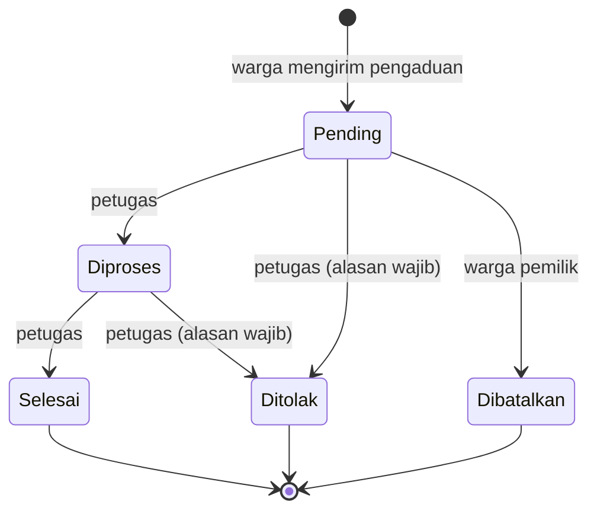

# 4. Status, SLA, dan Eskalasi

Ini **inti aturan bisnis** WADULIN. Hampir semua fitur lain bergantung pada bab ini. Baca pelan-pelan.

## 4.1 Lima status pengaduan

Didefinisikan di `app/Enums/ComplaintStatus.php`.

| Status | Nilai DB | Arti | Status akhir? | Masih dihitung SLA? |
| --- | --- | --- | --- | --- |
| Pending | `pending` | Baru masuk, belum disentuh petugas | Tidak | Ya |
| Diproses | `diproses` | Petugas sudah memverifikasi dan sedang menangani | Tidak | Ya |
| Selesai | `selesai` | Masalah sudah ditangani | **Ya** | Tidak |
| Ditolak | `ditolak` | Bukan wewenang pemda, laporan palsu, dll. (alasan wajib) | **Ya** | Tidak |
| Dibatalkan | `dibatalkan` | Ditarik oleh warga sendiri | **Ya** | Tidak |

**Status akhir** (*final*) artinya tidak bisa berubah lagi. Dicek lewat `ComplaintStatus::isFinal()` (`:27`). Status yang **masih terbuka** didapat dari `ComplaintStatus::open()` (`:56`), yaitu Pending dan Diproses.

## 4.2 Siapa boleh memindahkan status ke mana



### Transisi oleh petugas

Ditulis di `ComplaintStatus::officerTransitions()` (`app/Enums/ComplaintStatus.php:37`):

```php
public function officerTransitions(): array
{
    return match ($this) {
        self::Pending => [self::Diproses, self::Ditolak],
        self::Diproses => [self::Selesai, self::Ditolak],
        default => [],
    };
}
```

Daftar ini dipakai di **tiga tempat**, jadi aturan cukup diubah di satu tempat:

1. **Tampilan**: tombol aksi di `resources/views/admin/complaints/show.blade.php` hanya menampilkan transisi yang diizinkan.
2. **Validasi**: `UpdateComplaintStatusRequest::rules()` menolak status di luar daftar.
3. **Model**: `Complaint::transitionTo()` melempar exception kalau transisi tidak ada di daftar.

> **Kenapa Pending tidak bisa langsung ke Selesai?** Supaya ada jejak bahwa petugas memverifikasi laporan dulu (tahap Diproses) sebelum menyatakan selesai. Ini juga mencegah petugas "menutup" laporan tanpa benar-benar menangani.

> **Kenapa Selesai tidak bisa dibuka lagi?** Untuk menjaga integritas statistik dan audit. Kalau masalahnya muncul lagi, warga membuat pengaduan baru dengan kode tiket baru.

### Transisi oleh warga

Warga hanya punya satu transisi: **Pending → Dibatalkan**. Ditulis terpisah di `Complaint::cancelBy()` (`app/Models/Complaint.php:190`), bukan di `officerTransitions()`, karena aturannya berbeda (pelakunya pemilik pengaduan, bukan petugas).

```php
public function cancelBy(User $reporter, ?string $reason = null): void
{
    if ($this->status !== ComplaintStatus::Pending) {
        throw new InvalidArgumentException('Hanya pengaduan berstatus Pending yang dapat dibatalkan.');
    }

    $this->recordStatusChange(ComplaintStatus::Dibatalkan, $reporter, $reason, true);
}
```

> **Kenapa hanya saat Pending?** Begitu petugas memproses, sudah ada tenaga dan biaya yang dikeluarkan. Membatalkan di tengah jalan akan mengacaukan pekerjaan lapangan.

### Satu jalur penyimpanan: `recordStatusChange()`

`transitionTo()` (petugas) dan `cancelBy()` (warga) sama-sama berakhir di method privat `recordStatusChange()` (`:202`):

```php
private function recordStatusChange(ComplaintStatus $target, User $actor, ?string $note, bool $isPublicNote): void
{
    DB::transaction(function () use ($target, $actor, $note, $isPublicNote): void {
        $fromStatus = $this->status;
        $this->status = $target;

        if ($target->isFinal()) {
            $this->resolved_at = now();
            $this->escalated_at = null;
        }

        $this->save();

        $this->statusHistories()->create([
            'changed_by' => $actor->id,
            'from_status' => $fromStatus,
            'to_status' => $target,
            'note' => $note,
            'is_public' => $isPublicNote,
        ]);
    });
}
```

Yang terjadi:

1. Status baru disimpan.
2. Kalau status akhir: `resolved_at` diisi (dipakai untuk menghitung lama penanganan) dan tanda eskalasi dihapus (sudah tidak perlu dipantau).
3. Satu baris riwayat ditambahkan.

> **Kenapa dijadikan satu method?** Supaya **tidak mungkin** status berubah tanpa riwayat tercatat. Kalau setiap tempat menulis kodenya sendiri, cepat atau lambat ada yang lupa menulis riwayat. Method ini `private`, jadi dari luar model satu-satunya pintu adalah `transitionTo()` atau `cancelBy()`, dan keduanya punya pemeriksaan aturan.

### Baris riwayat pertama

Saat pengaduan dibuat, `ComplaintController::store()` langsung menulis riwayat pertama dengan `from_status = null` dan `to_status = pending`. Di timeline, baris ini tampil sebagai "Pengaduan dikirim"/"Pengaduan diterima".

## 4.3 SLA: batas waktu penanganan

**SLA** (*Service Level Agreement*) adalah janji layanan: "pengaduan ditindaklanjuti dalam N hari kerja". Disimpan di kolom `complaints.due_at`.

### Cara menghitung

`Complaint::calculateDueAt()` (`app/Models/Complaint.php:170`):

```php
public static function calculateDueAt(Carbon $from): Carbon
{
    return $from->copy()->addWeekdays(config('wadulin.sla_working_days'));
}
```

- `addWeekdays(3)` menambah 3 **hari kerja** (Senin–Jumat). Pengaduan Jumat sore jatuh tempo Rabu sore, bukan Senin.
- `copy()` penting! Objek Carbon bisa berubah (*mutable*). Tanpa `copy()`, variabel `$from` milik pemanggil ikut bergeser.
- Hari libur nasional **belum** diperhitungkan (lihat [bab 11](11-panduan-kerja.md#117-keterbatasan-yang-diketahui)).

### Dari mana angka 3?

`config/wadulin.php`:

```php
'sla_working_days' => (int) env('WADULIN_SLA_WORKING_DAYS', 3),
```

Bisa diubah lewat `.env` tanpa menyentuh kode. Tampilan (beranda, footer, FAQ) juga membaca `config('wadulin.sla_working_days')`, jadi angka di layar selalu sama dengan aturan sebenarnya.

> **Kenapa lewat `config()` dan bukan langsung `env()` di kode?** Di produksi Laravel menyimpan konfigurasi ke cache (`php artisan config:cache`). Setelah itu `env()` di luar folder `config/` mengembalikan `null`. Aturan Laravel: `env()` hanya boleh dipanggil di file `config/`.

### Kapan `due_at` diisi atau diubah

| Kejadian | `due_at` | Kode |
| --- | --- | --- |
| Pengaduan dibuat | sekarang + N hari kerja | `ComplaintController::store()` |
| Disposisi ke kecamatan lain | **diulang** dari sekarang | `Complaint::disposeTo()` (`:244`) |
| Status Pending → Diproses | tidak berubah | — |

> **Kenapa SLA diulang saat disposisi?** Kecamatan tujuan baru menerima pengaduan itu. Tidak adil kalau mereka langsung dianggap terlambat karena waktu yang habis di kecamatan sebelumnya.

> **Kenapa SLA tidak berhenti saat Diproses?** SLA di sini mengukur sampai pengaduan **tuntas**, bukan sekadar disentuh. Pengaduan Diproses yang berlarut-larut tetap perlu dipantau kabupaten.

### Menampilkan SLA

Komponen `resources/views/components/sla-chip.blade.php` menampilkan label:

| Kondisi | Label |
| --- | --- |
| Status akhir | `—` |
| `due_at` sudah lewat | **Terlambat N hari** (merah) |
| Tersisa ≤ 24 jam | **≤ 24 jam** (kuning) |
| Lainnya | **Aman · N hari** (hijau) |

Filter "SLA" di daftar pengaduan admin (`Admin\ComplaintController::index`) memakai logika yang sama: `lewat` → `overdue()`, `24jam` → `due_at` antara sekarang dan besok.

## 4.4 Eskalasi: menaikkan pengaduan yang terlambat

**Eskalasi** artinya pengaduan yang melewati SLA "dinaikkan" agar petugas kabupaten ikut turun tangan.

### Bagaimana pengaduan menjadi tereskalasi

Lewat perintah artisan `complaints:escalate` di `routes/console.php`:

```php
Artisan::command('complaints:escalate', function () {
    $count = Complaint::query()
        ->overdue()
        ->whereNull('escalated_at')
        ->update(['escalated_at' => now()]);

    $this->info("{$count} pengaduan dieskalasi ke kabupaten.");
})->purpose('Tandai pengaduan yang melewati batas SLA sebagai tereskalasi');

Schedule::command('complaints:escalate')->hourly()->withoutOverlapping();
```

Penjelasan:

- `overdue()` → status terbuka dan `due_at` sudah lewat.
- `whereNull('escalated_at')` → hanya yang belum pernah dieskalasi. Pengaduan yang sudah tereskalasi tidak diubah waktunya.
- `->update([...])` → satu query `UPDATE` untuk semua baris sekaligus. Jauh lebih cepat daripada mengambil satu per satu lalu menyimpan.
- `Schedule::...->hourly()` → dijalankan otomatis tiap jam **kalau scheduler aktif** (`php artisan schedule:work` saat development, atau cron `schedule:run` di server).
- `withoutOverlapping()` → kalau proses sebelumnya belum selesai, proses baru tidak dimulai. Mencegah dua proses berjalan bersamaan.

> **Kenapa eskalasi disimpan sebagai kolom `escalated_at`, bukan dihitung langsung dari `due_at < now()`?**
> 1. Kita tahu **kapan** pengaduan dieskalasi (berguna untuk laporan).
> 2. Hak akses kabupaten bergantung pada status eskalasi (lihat di bawah). Memakai tanda yang tersimpan membuat aturan izin stabil dan mudah dites.
> 3. Kalau nanti eskalasi perlu mengirim notifikasi, cukup ditambah di perintah ini, dan dijamin hanya terkirim sekali.

### Kapan tanda eskalasi dihapus

| Kejadian | Efek pada `escalated_at` |
| --- | --- |
| Status menjadi akhir (Selesai/Ditolak/Dibatalkan) | dihapus (`null`) |
| Disposisi ke kecamatan lain | dihapus, dan SLA diulang |
| Pending → Diproses | **tetap**, karena pengaduan masih terlambat dan belum tuntas |

Method `Complaint::isEscalated()` (`:145`) mengembalikan `true` kalau `escalated_at` terisi **dan** status belum akhir.

### Apa yang berubah saat tereskalasi

Aturan di `app/Policies/ComplaintPolicy.php`:

```php
public function updateStatus(User $user, Complaint $complaint): bool
{
    if ($complaint->status->isFinal()) {
        return false;
    }

    return match ($user->role) {
        UserRole::AdminKecamatan => $complaint->district_id === $user->district_id,
        UserRole::AdminKabupaten => $complaint->isEscalated(),
        UserRole::Masyarakat => false,
    };
}
```

| Peran | Bisa ubah status? | Bisa disposisi? |
| --- | --- | --- |
| Admin kecamatan (kecamatan yang sama) | Ya, selama belum final | Ya, **hanya saat Pending** |
| Admin kabupaten | **Hanya kalau tereskalasi** | **Hanya kalau tereskalasi** |
| Warga | Tidak | Tidak |

> **Kenapa kabupaten tidak boleh langsung mengubah semua pengaduan?** Prinsipnya: kecamatan adalah penanggung jawab utama. Kabupaten bisa **melihat** semuanya untuk memantau, tapi baru **bertindak** kalau kecamatan terlambat. Kalau kabupaten bebas mengambil alih, tanggung jawab jadi kabur.

> **Kenapa kecamatan masih bisa mengubah status pengaduan yang sudah tereskalasi?** Supaya kecamatan tetap bisa menyelesaikan tunggakannya. Eskalasi menambah pihak yang mengawasi, bukan mencabut tanggung jawab kecamatan.

### Di mana eskalasi terlihat

- Badge ungu **Tereskalasi** di samping status (`components/status-badge.blade.php`, parameter `:escalated`).
- Halaman **Eskalasi** khusus kabupaten: `Admin\EscalationController` → `/kabupaten/eskalasi`, diurutkan dari yang paling lama terlambat (`orderBy('due_at')`).
- KPI "Eskalasi aktif" dan "Melewati SLA" di dashboard admin.
- Pesan "Pengaduan ini melewati batas waktu dan kini ikut dipantau Pemkab" di halaman detail milik warga.

## 4.5 Disposisi: memindahkan ke kecamatan lain

Kadang warga salah memilih kecamatan, atau lokasi ternyata di perbatasan. Petugas bisa **mendisposisikan** pengaduan ke kecamatan yang benar.

Alur di `Complaint::disposeTo()` (`app/Models/Complaint.php:229`):

1. Tolak kalau kecamatan tujuan sama dengan sekarang.
2. Dalam satu transaksi:
   - Tulis baris di `complaint_dispositions` (dari, ke, oleh siapa, alasan).
   - Ganti `district_id` ke kecamatan tujuan.
   - Ulang `due_at` dari sekarang.
   - Hapus `escalated_at`.

Syarat (dari `ComplaintPolicy::dispose`):

- **Kecamatan**: hanya untuk pengaduan di kecamatannya **dan masih Pending**. Kalau sudah Diproses, berarti kecamatan sudah menerima tanggung jawab.
- **Kabupaten**: hanya untuk pengaduan tereskalasi.

Validasi di `StoreComplaintDispositionRequest`: kecamatan tujuan wajib ada di database, berbeda dari yang sekarang (`Rule::notIn`), dan alasan minimal 10 karakter.

Setelah disposisi oleh petugas kecamatan, pengaduan **tidak lagi terlihat** olehnya (karena `district_id` sudah berubah). Karena itu controller mengarahkan petugas kecamatan kembali ke daftar antrian, bukan ke halaman detail yang sudah tidak bisa ia buka.

## 4.6 Ringkasan kolom waktu

| Kolom | Diisi saat | Dihapus saat | Dipakai untuk |
| --- | --- | --- | --- |
| `created_at` | Dibuat | — | Urutan, statistik |
| `due_at` | Dibuat, disposisi | — | SLA, eskalasi, filter |
| `escalated_at` | Perintah eskalasi | Status akhir, disposisi | Hak akses kabupaten, badge |
| `resolved_at` | Status akhir | — | Rata-rata lama penanganan, persentase tepat waktu |

Lanjut ke [bab 5: Fitur publik](05-fitur-publik.md).
