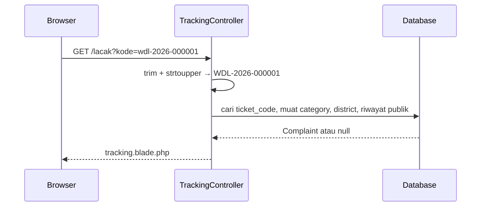
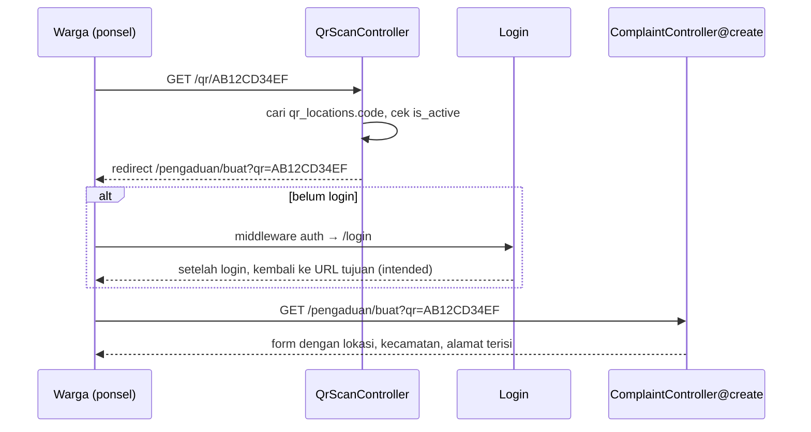

# 5. Fitur Publik (tanpa login)

Semua fitur di bab ini bisa dibuka siapa saja. Route-nya ada di `routes/web.php:28-35`, di luar grup middleware `auth`.

| Fitur | URL | Nama route | Controller | View |
| --- | --- | --- | --- | --- |
| Beranda | `/` | `beranda` | `HomeController` | `beranda.blade.php` |
| Lacak tiket | `/lacak?kode=...` | `lacak` | `TrackingController` | `tracking.blade.php` |
| Peta aduan | `/peta` | `peta` | `PublicMapController` | `map.blade.php` |
| Daftar pengumuman | `/pengumuman` | `pengumuman.index` | `AnnouncementController@index` | `announcements/index.blade.php` |
| Detail pengumuman | `/pengumuman/{slug}` | `pengumuman.show` | `AnnouncementController@show` | `announcements/show.blade.php` |
| Bantuan (FAQ) | `/faq` | `faq` | `FaqController` | `faq.blade.php` |
| Scan QR | `/qr/{kode}` | `qr.scan` | `QrScanController` | (redirect) |

## Prinsip privasi untuk semua halaman publik

> **Halaman publik tidak pernah menampilkan identitas pelapor.**

Caranya bukan dengan "menyembunyikan di view", tapi dengan **tidak mengambil datanya sama sekali**. Perhatikan bahwa controller publik tidak pernah memuat relasi `user`. Kalau datanya tidak diambil, tidak mungkin bocor walau ada kesalahan di view. Tes `TrackingTest` dan `PublicPagesTest` memastikan nama pelapor tidak muncul.

---

## 5.1 Beranda

**File:** `app/Http/Controllers/HomeController.php`, `resources/views/beranda.blade.php`

### Apa yang ditampilkan

1. Judul, penjelasan singkat, tombol "Buat pengaduan".
2. Kotak "Lacak pengaduan" dengan jumlah Menunggu / Ditangani / Selesai.
3. Empat angka statistik: total pengaduan, persentase selesai tepat waktu, rata-rata lama penanganan, jumlah kecamatan.
4. Empat langkah cara melapor.
5. Enam aduan terbaru (tanpa nama pelapor).
6. Daftar kategori dengan jumlah aduan 12 bulan terakhir.
7. Tiga pengumuman terbaru (kalau ada).

### Bagaimana statistik dihitung

```php
$statusCounts = Complaint::query()
    ->toBase()
    ->selectRaw('status, count(*) as total')
    ->groupBy('status')
    ->pluck('total', 'status');
```

Satu query menghitung jumlah per status sekaligus, hasilnya seperti `['pending' => 25, 'diproses' => 7, ...]`. `toBase()` membuat Laravel tidak mengubah hasil menjadi objek model (lebih ringan, karena kita hanya butuh angka).

Persentase tepat waktu dan rata-rata hari dihitung dari pengaduan berstatus Selesai:

- **Tepat waktu**: `resolved_at <= due_at`.
- **Rata-rata hari**: selisih jam `created_at` → `resolved_at`, dibagi 24.

Kategori memakai `withCount` dengan syarat 12 bulan terakhir:

```php
Category::active()
    ->withCount(['complaints' => fn ($query) => $query->where('created_at', '>=', now()->subYear())])
    ->orderByDesc('complaints_count')
```

`withCount` menambahkan atribut `complaints_count` ke setiap kategori dalam **satu query**, bukan satu query per kategori.

Aduan terbaru memilih kolom secukupnya (`get([...])`) dan relasi secukupnya (`category:id,name`). Pengaduan yang dibatalkan tidak ditampilkan karena tidak relevan untuk publik.

> **Kenapa statistiknya harus data asli?** Sebelumnya beranda berisi angka karangan ("12.480 pengaduan"). Untuk layanan pemerintah, angka palsu merusak kepercayaan. Kalau datanya masih sedikit, tampilkan apa adanya. Kalau belum ada data selesai, tampil `—`.

> **Catatan performa:** persentase dan rata-rata dihitung di PHP setelah mengambil semua pengaduan Selesai. Untuk ribuan data masih aman. Kalau datanya sudah ratusan ribu, sebaiknya dihitung langsung di SQL atau di-*cache*.

---

## 5.2 Lacak tiket

**File:** `app/Http/Controllers/TrackingController.php`, `resources/views/tracking.blade.php`

### Alur



```php
$code = strtoupper($request->string('kode')->trim()->toString());

$complaint = $code === '' ? null : Complaint::query()
    ->with([
        'category',
        'district',
        'statusHistories' => fn ($query) => $query->where('is_public', true)->oldest(),
    ])
    ->where('ticket_code', $code)
    ->first();
```

Poin penting:

- **Huruf besar otomatis.** Warga sering mengetik huruf kecil. `strtoupper` membuat `wdl-2026-000001` tetap ketemu.
- **Hanya riwayat publik.** `where('is_public', true)` di dalam eager load. Catatan internal petugas tidak pernah sampai ke halaman ini.
- **Tidak memuat `user`.** Lihat prinsip privasi di atas.
- **Pakai GET, bukan POST.** Hasil pencarian bisa di-bookmark atau dibagikan sebagai link (`/lacak?kode=...`). Beranda dan peta juga menautkan ke halaman ini.
- **Throttle `10,1`** (`routes/web.php:30`): maksimal 10 request per menit per IP. Mencegah orang mencoba ribuan kode tiket untuk mengintip pengaduan.

View menampilkan tiga keadaan: belum mengisi kode, kode tidak ditemukan (pesan merah), atau detail + timeline.

---

## 5.3 Peta aduan

**File:** `app/Http/Controllers/PublicMapController.php`, `resources/views/map.blade.php`

### Backend: menyiapkan titik

```php
$markers = Complaint::query()
    ->with(['category:id,name', 'district:id,name'])
    ->whereIn('status', [ComplaintStatus::Pending, ComplaintStatus::Diproses, ComplaintStatus::Selesai])
    ->latest()
    ->limit(500)
    ->get([...])
    ->map(fn (Complaint $complaint): array => [
        'lat' => (float) $complaint->latitude,
        'lng' => (float) $complaint->longitude,
        'ticket' => $complaint->ticket_code,
        'title' => $complaint->title,
        // ...
        'color' => $complaint->status->hexColor(),
        'url' => route('lacak', ['kode' => $complaint->ticket_code]),
    ]);
```

- Ditolak dan Dibatalkan tidak ditampilkan karena bukan masalah yang sedang/sudah ditangani.
- **Batas 500** supaya halaman tidak berat di ponsel.
- Data diubah menjadi array sederhana (`map`) yang **hanya berisi field yang aman untuk publik**. Ini lapisan privasi tambahan: walau model punya banyak kolom, hanya yang ada di array ini yang dikirim ke browser.
- Warna titik berasal dari `ComplaintStatus::hexColor()`, sama dengan warna di badge status, supaya konsisten.

### Frontend: menggambar peta

Di view, data dikirim ke JavaScript dengan `@json($markers)`, lalu digambar dengan Leaflet:

```js
const markers = @json($markers);
const map = L.map('map').setView([-8.1724, 113.7008], 10);   // pusat Jember
L.tileLayer('https://{s}.tile.openstreetmap.org/{z}/{x}/{y}.png', {...}).addTo(map);

markers.forEach(function (m) {
    L.circleMarker([m.lat, m.lng], {...fillColor: m.color...})
        .addTo(map)
        .bindPopup('...' + escape(m.title) + '...');
});
```

> **Kenapa ada fungsi `escape()`?** Judul pengaduan ditulis oleh warga. Kalau ada yang menulis judul berisi `<script>...</script>` lalu kita memasukkannya ke HTML popup apa adanya, script itu akan berjalan di browser pengunjung lain (serangan **XSS**). `escape()` mengubah `<` menjadi `&lt;` dan seterusnya. Di Blade, `{{ }}` sudah otomatis meng-escape, tapi di JavaScript kita harus melakukannya sendiri.

---

## 5.4 Pengumuman

**File:** `app/Http/Controllers/AnnouncementController.php`, `resources/views/announcements/`

- `index()`: pengumuman terbit, terbaru dulu, 9 per halaman (`paginate(9)`).
- `show()`: dicari lewat `slug` (karena `getRouteKeyName()` di model). Sebelum ditampilkan, dicek:

```php
abort_unless($announcement->is_published && $announcement->published_at?->isPast(), 404);
```

> **Kenapa perlu dicek lagi di `show()`?** Route model binding mengambil pengumuman apa pun yang slug-nya cocok, termasuk draf. Tanpa pemeriksaan ini, orang yang menebak slug draf bisa membacanya. Mengembalikan 404 (bukan 403) juga tidak memberi tahu bahwa draf itu ada.

Kartu pengumuman dipakai ulang di beranda dan halaman daftar lewat `@include('announcements._card')`. File berawalan garis bawah (`_card`) adalah konvensi proyek ini untuk *partial* (potongan view yang tidak berdiri sendiri).

Cara admin membuat pengumuman ada di [bab 7](07-fitur-petugas.md#79-pengumuman-kabupaten).

---

## 5.5 Bantuan (FAQ)

**File:** `app/Http/Controllers/FaqController.php`, `resources/views/faq.blade.php`

```php
Faq::published()->orderBy('sort_order')->orderBy('id')->get()
```

Diurutkan berdasarkan `sort_order`, lalu `id` sebagai penentu kalau angkanya sama. Tampilan memakai elemen HTML `<details>`/`<summary>` untuk buka-tutup jawaban, jadi **tidak butuh JavaScript**.

FAQ awal diisi `FaqSeeder`. Salah satu jawabannya membaca `config('wadulin.sla_working_days')`, jadi angka hari SLA di FAQ selalu sesuai konfigurasi saat seeder dijalankan.

---

## 5.6 Scan QR

**File:** `app/Http/Controllers/QrScanController.php`

Petugas menempel poster QR di fasilitas umum (taman, halte, pasar). Isi QR adalah URL `https://.../qr/AB12CD34EF`.



```php
public function __invoke(QrLocation $qrLocation): RedirectResponse
{
    abort_unless($qrLocation->is_active, 404);

    return redirect()->route('pengaduan.create', ['qr' => $qrLocation->code]);
}
```

- Route `/qr/{qrLocation:code}` mencari berdasarkan kolom `code`.
- QR nonaktif → 404.
- Halaman scan tidak butuh login. Yang butuh login adalah form pengaduan. Kalau warga belum login, Laravel menyimpan URL tujuan, lalu setelah login `redirect()->intended(...)` di `AuthenticatedSessionController` membawanya kembali ke form dengan parameter `qr` masih utuh.

> **Kenapa tidak langsung menampilkan form di URL `/qr/...`?** Supaya form pengaduan tetap satu (`pengaduan.create`). Kalau ada perubahan pada form, cukup diubah di satu tempat. Scan QR hanya "pintu masuk" yang mengisi parameter.

Bagaimana form memakai parameter `qr` dijelaskan di [bab 6.4](06-fitur-warga.md#64-membuat-pengaduan). Cara petugas membuat titik QR ada di [bab 7.7](07-fitur-petugas.md#77-titik-qr-kecamatan--kabupaten).

Lanjut ke [bab 6: Fitur warga](06-fitur-warga.md).
