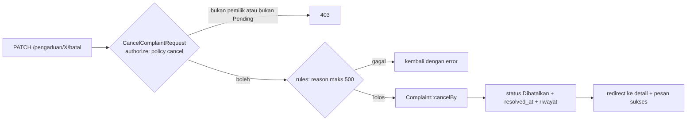

# 6. Fitur Warga

Bab ini membahas semua yang dilakukan warga: mendaftar, masuk, membuat pengaduan, memantau, membatalkan, menilai, dan membaca notifikasi.

Route warga ada di `routes/web.php:51-60`, di dalam grup:

```php
Route::middleware(['auth', 'role:masyarakat'])->group(function (): void { ... });
```

Artinya semua route di dalamnya **wajib login** dan **wajib berperan warga**. Petugas yang mencoba membuka `/dashboard` akan mendapat 403.

| Fitur | Method + URL | Nama route | Controller |
| --- | --- | --- | --- |
| Dashboard | `GET /dashboard` | `dashboard` | `DashboardController` |
| Daftar pengaduan saya | `GET /pengaduan` | `pengaduan.index` | `ComplaintController@index` |
| Form pengaduan | `GET /pengaduan/buat` | `pengaduan.create` | `ComplaintController@create` |
| Kirim pengaduan | `POST /pengaduan` | `pengaduan.store` | `ComplaintController@store` |
| Detail pengaduan | `GET /pengaduan/{tiket}` | `pengaduan.show` | `ComplaintController@show` |
| Batalkan | `PATCH /pengaduan/{tiket}/batal` | `pengaduan.cancel` | `ComplaintCancellationController` |
| Beri nilai | `POST /pengaduan/{tiket}/penilaian` | `pengaduan.rating` | `ComplaintRatingController` |
| Tandai notifikasi dibaca | `POST /notifikasi/baca` | `notifikasi.read` | `ReadNotificationsController` |

> **Urutan route itu penting.** `/pengaduan/buat` ditulis **sebelum** `/pengaduan/{complaint}`. Kalau dibalik, Laravel akan mengira kata `buat` adalah kode tiket dan mencari pengaduan bernama "buat" (hasilnya 404).

---

## 6.1 Mendaftar

**File:** `app/Http/Controllers/Auth/RegisteredUserController.php`, `app/Http/Requests/StoreUserRequest.php`, `resources/views/auth/register.blade.php`

```php
public function store(StoreUserRequest $request): RedirectResponse
{
    $user = User::create([
        ...$request->safe()->only(['name', 'email', 'password', 'phone']),
        'role' => UserRole::Masyarakat,
    ]);

    Auth::login($user);

    return redirect()->intended(route('dashboard'))->with('success', 'Akun berhasil dibuat. Selamat datang di WADULIN!');
}
```

- `$request->safe()->only([...])` hanya mengambil empat field yang sudah divalidasi. Kalau ada yang mengirim field `role` secara diam-diam, field itu dibuang.
- `role` **selalu** diisi `Masyarakat` oleh kode. Akun petugas hanya bisa dibuat admin kabupaten ([bab 7.11](07-fitur-petugas.md#711-akun-petugas-kabupaten)).
- Kata sandi tidak di-*hash* manual karena model `User` punya cast `'password' => 'hashed'`.
- Setelah daftar, user langsung dalam keadaan login.

Aturan validasi di `StoreUserRequest`:

| Field | Aturan | Alasan |
| --- | --- | --- |
| `name` | wajib, 3–100 karakter | |
| `email` | wajib, format email, unik | Satu email satu akun |
| `phone` | wajib, regex `^(08\|\+628)[0-9]{8,12}$` | Format nomor HP Indonesia |
| `password` | wajib, `confirmed`, min 8, huruf dan angka | `confirmed` artinya harus sama dengan field `password_confirmation` |

Route ini memakai `throttle:5,1` (maksimal 5 percobaan per menit) untuk mencegah pendaftaran massal oleh bot.

---

## 6.2 Masuk dan keluar

**File:** `app/Http/Controllers/Auth/AuthenticatedSessionController.php`, `app/Http/Requests/LoginRequest.php`, `resources/views/auth/login.blade.php`

Login (`store`, baris 20):

```php
$credentials = [...$request->only('email', 'password'), 'is_active' => true];

if (! Auth::attempt($credentials, $request->boolean('remember'))) {
    throw ValidationException::withMessages(['email' => 'Email atau password salah.']);
}

$request->session()->regenerate();
$user->forceFill(['last_login_at' => now()])->save();

return redirect()->intended(route($user->role->homeRoute()));
```

Penjelasan baris per baris:

1. **`'is_active' => true` ikut dicek.** `Auth::attempt` mencari user yang email-nya cocok **dan** aktif. Akun nonaktif ditolak dengan pesan yang sama seperti kata sandi salah.
2. **Pesan error sengaja umum** ("Email atau password salah"), tidak menyebut mana yang salah. Kalau pesannya "email tidak terdaftar", orang bisa mengecek email siapa saja yang punya akun.
3. **`session()->regenerate()`** membuat ID sesi baru setelah login. Ini mencegah serangan *session fixation*.
4. **`forceFill`** dipakai karena `last_login_at` sengaja tidak dimasukkan ke `#[Fillable]` (tidak boleh diisi dari input pengguna).
5. **`redirect()->intended(...)`**: kalau user tadinya mau membuka halaman tertentu (misalnya form pengaduan dari scan QR), ia dikembalikan ke sana. Kalau tidak, ia diarahkan ke halaman utama sesuai perannya (`UserRole::homeRoute()`).

Keluar (`destroy`): `Auth::logout()`, lalu `invalidate()` dan `regenerateToken()` supaya sesi dan token CSRF lama tidak bisa dipakai lagi.

**User yang sudah login membuka `/login`?** Route login ada di grup middleware `guest`. Laravel mengalihkan user yang sudah login ke alamat dari `redirectUsersTo` di `bootstrap/app.php:20`, yaitu halaman utama sesuai perannya.

Tabel akun demo di halaman login hanya muncul kalau `app()->isLocal()` (`APP_ENV=local`), supaya tidak bocor di server produksi.

---

## 6.3 Dashboard warga

**File:** `app/Http/Controllers/DashboardController.php`, `resources/views/dashboard.blade.php`

Menampilkan:

1. Jumlah pengaduan per status (Pending, Diproses, Selesai, Ditolak). Setiap kotak adalah link ke daftar yang sudah difilter.
2. Lima pengaduan terbaru.
3. Lima notifikasi terbaru + jumlah yang belum dibaca.

```php
'statusCounts' => $user->complaints()->toBase()
    ->selectRaw('status, count(*) as total')
    ->groupBy('status')
    ->pluck('total', 'status'),
```

`$user->complaints()` (relasi) otomatis membatasi ke pengaduan milik user itu. Di view, `$statusCounts[$status->value] ?? 0` memberi 0 untuk status yang belum punya pengaduan.

---

## 6.4 Membuat pengaduan

Fitur terpenting bagi warga. Melibatkan banyak file:

| Peran | File |
| --- | --- |
| Menampilkan form | `ComplaintController::create()` (`:38`) |
| Form + peta | `resources/views/complaints/create.blade.php` |
| Validasi | `app/Http/Requests/StoreComplaintRequest.php` |
| Menyimpan | `ComplaintController::store()` (`:49`) |
| Kode tiket & SLA | `Complaint::nextTicketCode()`, `Complaint::calculateDueAt()` |

### a. Menampilkan form (`create`)

```php
public function create(Request $request): View
{
    $qrCode = $request->string('qr')->trim()->toString();

    return view('complaints.create', [
        'categories' => Category::active()->orderBy('name')->get(),
        'districts' => District::orderBy('name')->get(),
        'qrLocation' => $qrCode === '' ? null : QrLocation::active()->with('district')->where('code', $qrCode)->first(),
    ]);
}
```

- Hanya kategori aktif yang ditampilkan.
- Kalau URL punya `?qr=KODE` (dari scan QR) dan titiknya aktif, `$qrLocation` terisi. View memakainya sebagai nilai awal:

```blade
<input type="hidden" name="latitude" value="{{ old('latitude', $qrLocation?->latitude) }}">
```

`old('latitude', default)` artinya: kalau formulir baru saja gagal validasi, pakai isian sebelumnya; kalau tidak, pakai koordinat dari QR. Operator `?->` (*nullsafe*) mengembalikan `null` kalau `$qrLocation` kosong, tanpa error.

- Kalau ada `qr_location_id` tersembunyi di form, pengaduan tercatat berasal dari titik QR itu.
- Kalau kode QR tidak dikenali, muncul pesan kuning dan warga memilih lokasi manual.

### b. Form dan peta

Form dibagi tiga bagian: **1. Jenis masalah**, **2. Lokasi**, **3. Detail**.

**Pemilihan kategori** memakai radio button yang disembunyikan (`sr-only`) dan label bergaya kotak. Class `peer` + `peer-checked:` (fitur Tailwind) membuat kotak berubah warna saat radio di dalamnya dipilih, tanpa JavaScript.

**Peta lokasi** memakai Leaflet (script di bagian bawah view):

```js
function setPoint(lat, lng) {
    latInput.value = lat.toFixed(7);
    lngInput.value = lng.toFixed(7);
    // buat atau pindahkan penanda
}
map.on('click', (e) => setPoint(e.latlng.lat, e.latlng.lng));
```

- Klik peta → penanda muncul dan koordinat disimpan ke dua input tersembunyi `latitude` dan `longitude`.
- Penanda bisa digeser (`draggable`), koordinat ikut diperbarui.
- Tombol "Pakai lokasi saya" memakai `navigator.geolocation` (GPS ponsel). Kalau izin ditolak, muncul pesan dan warga memilih manual.
- Saat halaman dibuka dengan nilai awal (dari QR atau `old()`), penanda langsung ditaruh di titik itu.

**Foto**: `<input type="file" name="photos[]" multiple>`. Tanda `[]` membuat PHP menerima beberapa file sebagai array.

### c. Validasi (`StoreComplaintRequest`)

| Field | Aturan | Alasan |
| --- | --- | --- |
| `category_id` | wajib, ada di tabel **dan aktif** | Mencegah memakai kategori yang sudah dinonaktifkan |
| `district_id` | wajib, ada di tabel | |
| `title` | 10–150 karakter | Judul terlalu pendek tidak informatif |
| `description` | 20–2000 karakter | |
| `address` | opsional, maks 500 | |
| `latitude` | wajib, antara -8.60 dan -7.90 | Kotak batas kasar Kabupaten Jember |
| `longitude` | wajib, antara 113.20 dan 114.10 | |
| `is_anonymous` | boolean | |
| `qr_location_id` | opsional, ada di `qr_locations` **dan aktif** | |
| `photos` | wajib, array, 1–3 file | Bukti wajib agar laporan bisa diverifikasi |
| `photos.*` | gambar, jpg/jpeg/png/webp, maks 2048 KB | `photos.*` artinya aturan berlaku untuk **setiap** file di array |

> **Kenapa koordinat dibatasi kotak Jember?** Supaya tidak ada laporan untuk lokasi di luar wilayah Pemkab Jember. Ini batas kasar berbentuk persegi, jadi sedikit wilayah kabupaten tetangga masih lolos. Untuk batas yang presisi, kolom `districts.boundary` disiapkan menyimpan poligon (belum dipakai).

> **Kenapa input `is_anonymous` punya dua elemen (hidden + checkbox)?** Checkbox yang tidak dicentang **tidak dikirim sama sekali** oleh browser. Input tersembunyi bernilai `0` dengan nama yang sama memastikan selalu ada nilai. Kalau checkbox dicentang, nilainya (`1`) menimpa yang tersembunyi karena letaknya lebih bawah. Pola ini dipakai di semua checkbox di proyek.

Route `pengaduan.store` punya `throttle:5,60`: maksimal 5 pengaduan per jam per user/IP, untuk mencegah spam.

### d. Menyimpan (`store`)

```php
$complaint = DB::transaction(function () use ($request, $user): Complaint {
    $complaint = Complaint::create([
        ...$request->safe()->except('photos'),
        'ticket_code' => Complaint::nextTicketCode(),
        'user_id' => $user->id,
        'status' => ComplaintStatus::Pending,
        'due_at' => Complaint::calculateDueAt(now()),
    ]);

    $complaint->statusHistories()->create([
        'changed_by' => $user->id,
        'from_status' => null,
        'to_status' => ComplaintStatus::Pending,
    ]);

    foreach ($request->file('photos', []) as $photo) {
        $complaint->attachments()->create([
            'type' => AttachmentType::Bukti,
            'file_path' => $photo->store('complaints/'.$complaint->ticket_code, 'public'),
            'mime_type' => $photo->getMimeType(),
            'size_kb' => (int) ceil($photo->getSize() / 1024),
            'uploaded_by' => $user->id,
        ]);
    }

    return $complaint;
});
```

Langkahnya:

1. **Buat pengaduan.** Data dari form (tanpa `photos`) digabung dengan data yang **ditentukan server**: kode tiket, pemilik, status Pending, batas SLA. Field ini sengaja tidak diambil dari input, supaya warga tidak bisa mengirim `status=selesai`.
2. **Tulis riwayat pertama** (`from_status = null`).
3. **Simpan foto** ke `storage/app/public/complaints/{kode-tiket}/`. `store()` memberi nama file acak supaya tidak bentrok dan tidak bisa ditebak.
4. Semua dalam **transaksi**. Kalau penyimpanan foto gagal, pengaduan dan riwayatnya ikut dibatalkan.
5. Redirect ke halaman detail dengan pesan "Simpan kode tiket ini".

### e. Kode tiket

`Complaint::nextTicketCode()` (`app/Models/Complaint.php:153`):

```php
$prefix = 'WDL-'.now()->year.'-';
$lastCode = static::withTrashed()
    ->where('ticket_code', 'like', $prefix.'%')
    ->orderByDesc('ticket_code')
    ->value('ticket_code');
$nextNumber = $lastCode === null ? 1 : ((int) substr($lastCode, strlen($prefix))) + 1;
return $prefix.str_pad((string) $nextNumber, 6, '0', STR_PAD_LEFT);
```

- Cari kode terbesar tahun ini, ambil angkanya, tambah 1, lalu isi nol di depan sampai 6 digit.
- Nomor mulai dari `000001` lagi setiap tahun baru.
- `withTrashed()` ikut menghitung pengaduan yang di-*soft delete*, supaya nomor tidak pernah dipakai dua kali.
- Pengurutan teks (`orderByDesc`) aman karena semua nomor punya panjang yang sama (6 digit dengan nol di depan).

> **Keterbatasan:** kalau dua warga mengirim pada milidetik yang sama, keduanya bisa mendapat nomor yang sama. Kolom `ticket_code` yang unik akan menolak salah satunya (error 500). Untuk volume saat ini risikonya kecil. Lihat [bab 11.7](11-panduan-kerja.md#117-keterbatasan-yang-diketahui).

### f. Kenapa foto disimpan di disk `public`?

Disk `public` = folder `storage/app/public`, yang ditautkan ke `public/storage` lewat `php artisan storage:link`. File di sana bisa dibuka langsung dari browser dengan `Storage::disk('public')->url($path)`. Ini sederhana, tapi artinya **siapa pun yang tahu URL foto bisa membukanya**. Nama file acak membuatnya sulit ditebak. Kalau nanti foto perlu benar-benar privat, pindahkan ke disk `local` dan tampilkan lewat controller yang mengecek izin.

---

## 6.5 Daftar pengaduan saya

**File:** `ComplaintController::index()` (`:20`), `resources/views/complaints/index.blade.php`, `complaints/_card.blade.php`

```php
$status = ComplaintStatus::tryFrom($request->string('status')->toString());

$request->user()->complaints()
    ->with(['category', 'district'])
    ->when($status, fn ($query) => $query->where('status', $status))
    ->latest()
    ->paginate(10)
    ->withQueryString();
```

- `tryFrom` mengubah teks `?status=selesai` menjadi enum. Kalau teksnya ngawur, hasilnya `null` (tidak error), dan filter diabaikan.
- `when($status, ...)`: filter hanya ditambahkan kalau `$status` ada.
- `with([...])`: *eager loading*. Tanpa ini, setiap kartu memicu query tambahan untuk kategori dan kecamatan (masalah **N+1 query**).
- `paginate(10)->withQueryString()`: 10 per halaman, dan link halaman berikutnya tetap membawa `?status=...`.

---

## 6.6 Detail pengaduan

**File:** `ComplaintController::show()` (`:86`), `resources/views/complaints/show.blade.php`

```php
Gate::authorize('view', $complaint);

$complaint->load([
    'category', 'district', 'attachments',
    'statusHistories' => fn ($query) => $query->where('is_public', true),
    'dispositions.toDistrict',
]);
```

- `Gate::authorize('view', ...)` memanggil `ComplaintPolicy::view()`. Untuk warga: hanya pemilik. Warga lain yang membuka URL pengaduan orang → **403**.
- Hanya riwayat **publik** yang dimuat. Catatan internal petugas tidak terlihat warga.

View menggabungkan riwayat status dan disposisi menjadi satu timeline yang diurutkan berdasarkan waktu:

```php
$timeline = $complaint->statusHistories->map(fn ($history) => ['at' => $history->created_at, 'type' => 'status', 'item' => $history])
    ->concat($complaint->dispositions->map(fn ($disposition) => ['at' => $disposition->created_at, 'type' => 'disposisi', 'item' => $disposition]))
    ->sortBy('at');
```

Di kolom kanan, kotak aksi muncul sesuai izin:

```blade
@can('rate', $complaint) ... form penilaian ... @endcan
@can('cancel', $complaint) ... form pembatalan ... @endcan
```

`@can` memanggil Policy yang sama dengan yang dipakai Form Request. Jadi **tombol hanya muncul kalau aksinya memang diizinkan**, dan aturan itu ditulis di satu tempat.

---

## 6.7 Membatalkan pengaduan

**File:** `ComplaintCancellationController`, `CancelComplaintRequest`, `ComplaintPolicy::cancel()` (`:45`), `Complaint::cancelBy()`



Policy:

```php
public function cancel(User $user, Complaint $complaint): bool
{
    return $complaint->user_id === $user->id
        && $complaint->status === ComplaintStatus::Pending;
}
```

Alasan pembatalan bersifat opsional dan disimpan sebagai catatan riwayat (publik). Form di view memakai `onsubmit="return confirm(...)"` supaya warga tidak membatalkan karena salah tekan.

Tidak ada notifikasi untuk pembatalan karena pelakunya warga itu sendiri.

---

## 6.8 Memberi penilaian

**File:** `ComplaintRatingController`, `StoreComplaintRatingRequest`, `ComplaintPolicy::rate()` (`:54`)

Policy:

```php
public function rate(User $user, Complaint $complaint): bool
{
    return $complaint->user_id === $user->id
        && $complaint->status === ComplaintStatus::Selesai
        && $complaint->rating === null;
}
```

Tiga syarat: pemilik, status Selesai, dan **belum pernah menilai**. Jadi penilaian hanya bisa diberikan sekali. Pengaduan Ditolak tidak bisa dinilai karena tidak ada hasil kerja yang dinilai.

Validasi: `rating` wajib, bilangan bulat 1–5; `feedback` opsional, maks 1000 karakter. Controller cukup `$complaint->update($request->validated())` karena `rating` dan `feedback` ada di `#[Fillable]`.

Nilai ini dipakai di dashboard admin (KPI "Rating rata-rata") dan ditampilkan di detail admin.

---

## 6.9 Notifikasi

**File:** `app/Notifications/ComplaintUpdated.php`, `ReadNotificationsController`, bagian notifikasi di `dashboard.blade.php`

### Kapan notifikasi dikirim

| Kejadian | Dikirim dari | Isi pesan |
| --- | --- | --- |
| Petugas mengubah status | `Admin\ComplaintStatusController` | "Status pengaduan kamu kini {Status}." + catatan, **hanya kalau catatannya publik** |
| Petugas mendisposisi | `Admin\ComplaintDispositionController` | "Pengaduan kamu dialihkan ke Kecamatan {X}..." |

### Isi class notifikasi

```php
class ComplaintUpdated extends Notification
{
    public function __construct(public Complaint $complaint, public string $message) {}

    public function via(object $notifiable): array
    {
        return ['database'];
    }

    public function toArray(object $notifiable): array
    {
        return [
            'ticket_code' => $this->complaint->ticket_code,
            'title' => $this->complaint->title,
            'status' => $this->complaint->status->value,
            'message' => $this->message,
        ];
    }
}
```

- `via()` menentukan **saluran**. Saat ini hanya `database` (disimpan ke tabel `notifications`). Kalau nanti mau email atau WhatsApp, tambahkan saluran di sini.
- `toArray()` menentukan isi kolom `data` (JSON). Isinya **salinan teks** saat notifikasi dibuat, bukan referensi ke model. Jadi kalau status berubah lagi, notifikasi lama tetap berbunyi sesuai keadaan saat itu.
- Pesan dibuat di controller (bukan di class notifikasi), karena controller yang tahu konteksnya (status apa, catatan publik atau tidak).

> **Kenapa catatan internal tidak dimasukkan ke notifikasi?** Petugas bisa menulis catatan untuk sesama petugas (`is_public = false`), misalnya "pelapor sudah 5 kali melapor hal sama". Notifikasi dibaca warga, jadi catatan internal tidak boleh ikut. Ada tes khusus: `ComplaintStatusUpdateTest::test_internal_note_is_not_leaked_in_notification`.

### Menampilkan dan menandai dibaca

Dashboard memuat `$user->notifications()->latest()->limit(5)` dan `$user->unreadNotifications()->count()`. Notifikasi yang belum dibaca diberi garis hijau dan huruf tebal. Setiap notifikasi adalah link ke detail pengaduan berdasarkan `data['ticket_code']`.

Tombol "Tandai dibaca" mengirim `POST /notifikasi/baca`:

```php
$request->user()->unreadNotifications()->update(['read_at' => now()]);
return back();
```

Satu query `UPDATE` untuk semua notifikasi yang belum dibaca.

Lanjut ke [bab 7: Fitur petugas](07-fitur-petugas.md).
