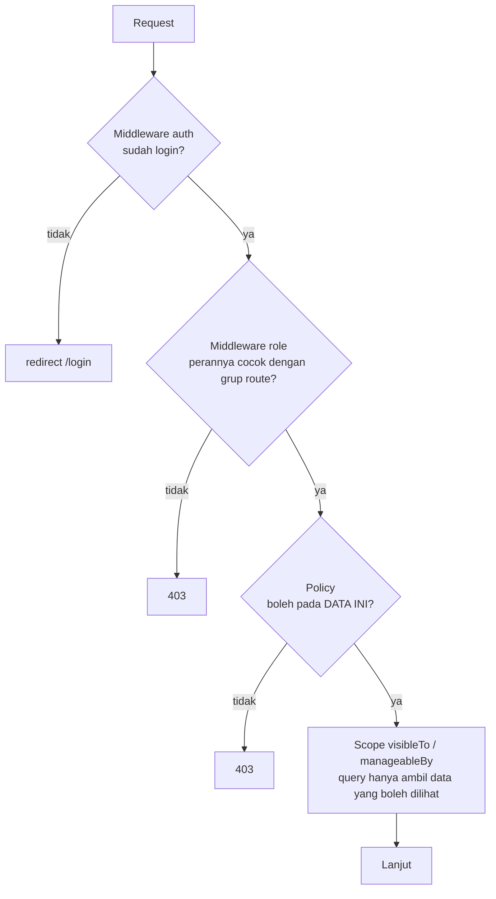

# 8. Keamanan dan Hak Akses

Aplikasi ini menyimpan data warga (nama, nomor HP, lokasi rumah) dan dipakai instansi pemerintah. Keamanan bukan tambahan, tapi bagian dari setiap fitur. Bab ini mengumpulkan semua mekanisme keamanan di satu tempat.

## 8.1 Tiga lapis penjaga hak akses

Setiap aksi dijaga berlapis. Kalau satu lapis terlewat karena bug, lapis lain masih menahan.



| Lapis | Menjawab | Contoh |
| --- | --- | --- |
| **Middleware `role`** | "Kamu boleh masuk ke **area** ini?" | Warga tidak bisa membuka `/kabupaten/...` sama sekali |
| **Policy** | "Kamu boleh melakukan **aksi ini** pada **data ini**?" | Petugas Patrang tidak boleh mengubah pengaduan Ambulu |
| **Scope query** | "Data **mana saja** yang boleh muncul di daftar?" | Daftar antrian Patrang hanya berisi pengaduan Patrang |

> **Kenapa middleware saja tidak cukup?** Middleware hanya tahu peran, tidak tahu data. Petugas Patrang dan petugas Ambulu sama-sama `admin_kecamatan`, jadi keduanya lolos middleware. Policy-lah yang membedakan berdasarkan `district_id`.

## 8.2 Middleware `role`

Sudah dibahas di [bab 2](02-alur-request-laravel.md#langkah-3--middleware-memeriksa). Ringkasnya:

- File: `app/Http/Middleware/EnsureUserHasRole.php`
- Didaftarkan sebagai alias `role` di `bootstrap/app.php`
- Dipakai per grup route: `role:masyarakat`, `role:admin_kecamatan`, `role:admin_kabupaten`

## 8.3 Policy

Policy adalah class berisi method yang mengembalikan `true`/`false`. Laravel menghubungkan policy dengan model secara otomatis berdasarkan nama.

### `ComplaintPolicy` (`app/Policies/ComplaintPolicy.php`)

| Method | Warga | Admin kecamatan | Admin kabupaten |
| --- | --- | --- | --- |
| `view` | Hanya miliknya | Hanya kecamatannya | Semua |
| `updateStatus` | Tidak | Kecamatannya, belum final | Hanya tereskalasi, belum final |
| `dispose` | Tidak | Kecamatannya **dan** Pending | Hanya tereskalasi |
| `cancel` | Miliknya **dan** Pending | Tidak | Tidak |
| `rate` | Miliknya, Selesai, belum dinilai | Tidak | Tidak |

### `QrLocationPolicy` (`app/Policies/QrLocationPolicy.php`)

| Method | Admin kecamatan | Admin kabupaten |
| --- | --- | --- |
| `update` | Hanya titik di kecamatannya | Semua |

### Cara policy dipanggil

Policy dipanggil dari tiga tempat. Pilih sesuai situasi:

| Cara | Di mana | Dipakai di proyek untuk |
| --- | --- | --- |
| `$this->user()->can('aksi', $model)` di `authorize()` Form Request | Aksi yang menerima input (POST/PATCH) | Ubah status, disposisi, batal, nilai, ubah QR |
| `Gate::authorize('aksi', $model)` di controller | Aksi tanpa Form Request (GET) | Detail pengaduan warga dan admin |
| `@can('aksi', $model)` / `->can()` di Blade | Menampilkan atau menyembunyikan tombol | Tombol batal, nilai, ubah status, disposisi |

> **Penting:** menyembunyikan tombol di view **bukan** pengamanan. Orang bisa mengirim request langsung tanpa tombol (misalnya lewat `curl`). Pengamanan sebenarnya ada di Form Request/controller. `@can` di view hanya supaya pengguna tidak melihat tombol yang pasti gagal.

### Form Request yang `authorize()`-nya `return true`

Beberapa Form Request (`StoreCategoryRequest`, `StoreOfficerRequest`, `StoreFaqRequest`, dll.) mengembalikan `true` dengan komentar "Access is restricted to admin_kabupaten by the route middleware". Ini aman **karena** route-nya ada di grup `role:admin_kabupaten`, dan aturannya tidak bergantung pada data tertentu. Kalau kamu memindahkan route seperti ini ke grup lain, periksa ulang `authorize()`-nya.

## 8.4 Scope query: mencegah kebocoran di daftar

Policy hanya bekerja untuk **satu** data. Untuk **daftar**, kita memakai scope:

```php
Complaint::query()->visibleTo($user)        // app/Models/Complaint.php:126
QrLocation::query()->manageableBy($user)    // app/Models/QrLocation.php:69
```

**Aturan wajib:** setiap query daftar pengaduan di panel admin harus memakai `visibleTo($user)`. Ini termasuk query untuk menghitung angka di dashboard. Kalau lupa, petugas kecamatan bisa melihat jumlah atau data kecamatan lain.

Ingat juga jebakan `orWhere` yang dijelaskan di [bab 7.3](07-fitur-petugas.md#73-daftar--antrian-pengaduan).

## 8.5 Validasi input

Semua input dari pengguna divalidasi di Form Request sebelum dipakai. Prinsipnya:

1. **Jangan percaya input.** Field tersembunyi, dropdown, dan radio button bisa diubah lewat alat developer browser. Karena itu `category_id` dicek "ada di database dan aktif", `status` dicek "ada di daftar transisi", dan seterusnya.
2. **Pakai data yang sudah divalidasi.** `$request->validated()`, `$request->safe()->only([...])`, atau `$request->validated('field')`. Hindari `$request->all()` untuk disimpan.
3. **Field penting diisi server.** `role`, `user_id`, `status`, `ticket_code`, `due_at`, `created_by`, `author_id` tidak pernah diambil dari input.

## 8.6 Mass assignment

Setiap model punya daftar `#[Fillable([...])]`. Kolom di luar daftar diabaikan saat `create()`/`update()`. Contoh: `last_login_at` sengaja tidak masuk fillable, jadi harus diisi dengan `forceFill()` di kode login.

## 8.7 Upload file

| Aturan | Di mana | Kenapa |
| --- | --- | --- |
| Hanya `image`, `mimes:jpg,jpeg,png,webp` | Form Request | Mencegah unggah file berbahaya, misalnya `.php` |
| Maks 2 MB per file, maks 3 file | Form Request | Mencegah penyimpanan penuh |
| Nama file acak (`$file->store(...)`) | Controller | Nama asli dari pengguna bisa berisi karakter aneh atau menimpa file lain |
| Disimpan per kode tiket | Controller | Mudah dirapikan |

Ingat bahwa disk `public` bisa diakses siapa pun yang tahu URL-nya ([bab 6.4](06-fitur-warga.md#f-kenapa-foto-disimpan-di-disk-public)).

## 8.8 Pembatasan laju (throttle)

| Route | Batas | Mencegah |
| --- | --- | --- |
| `POST /login` | 5 per menit | Menebak kata sandi (*brute force*) |
| `POST /register` | 5 per menit | Pendaftaran massal oleh bot |
| `GET /lacak` | 10 per menit | Menebak kode tiket untuk mengintip pengaduan |
| `POST /pengaduan` | 5 per jam | Spam pengaduan |

Ditulis sebagai middleware `throttle:jumlah,menit` di `routes/web.php`. Kalau terlampaui, Laravel mengembalikan **429 Too Many Requests**. Untuk user yang sudah login, hitungan per user. Untuk tamu, per alamat IP.

## 8.9 Serangan web umum dan penangkalnya

| Serangan | Penjelasan singkat | Penangkal di proyek |
| --- | --- | --- |
| **CSRF** | Situs jahat membuat browser korban mengirim formulir ke WADULIN | `@csrf` di setiap `<form method="POST">`. Laravel menolak request tanpa token. |
| **XSS** | Penyerang menyisipkan `<script>` lewat input (judul, deskripsi) | Blade `{{ }}` otomatis meng-escape. Di JavaScript peta, fungsi `escape()` manual. **Jangan pakai `{!! !!}`** untuk data dari pengguna. |
| **SQL Injection** | Input berisi potongan SQL | Query builder Eloquent memakai parameter binding. Hindari menempelkan input ke `DB::raw()`/`selectRaw()`. |
| **Session fixation** | Penyerang memaksa korban memakai ID sesi yang sudah ia ketahui | `session()->regenerate()` setelah login |
| **Enumeration** | Menebak ID berurutan untuk menemukan data | URL memakai kode tiket/slug/kode QR acak, plus throttle dan policy |
| **User enumeration** | Mengetahui email mana yang terdaftar dari pesan error login | Pesan login dibuat umum: "Email atau password salah" |

## 8.10 Privasi pelapor

Ringkasan semua mekanisme yang menjaga identitas warga:

1. **Controller publik tidak memuat relasi `user`** (`TrackingController`, `PublicMapController`, `HomeController`).
2. **Peta mengirim array terbatas** ke browser, bukan model utuh.
3. **Catatan internal** (`is_public = false`) disaring di halaman warga, halaman lacak, dan notifikasi.
4. **Data kontak pelapor** hanya tampil di panel petugas yang berhak (policy `view`).
5. **Flag `is_anonymous`** saat ini bersifat informasi untuk petugas. Halaman publik memang tidak pernah menampilkan nama siapa pun, jadi flag ini terpenuhi dengan sendirinya. Kalau nanti ada fitur publik yang menampilkan nama pelapor, **wajib** memeriksa flag ini.

## 8.11 403 atau 404?

Proyek ini memakai keduanya dengan sengaja:

- **403 Forbidden**: user tahu datanya ada, tapi tidak berhak. Contoh: warga membuka pengaduan orang lain (kode tiketnya memang sudah diketahui).
- **404 Not Found**: kita tidak ingin memberi tahu bahwa datanya ada. Contoh: draf pengumuman, QR nonaktif, mengedit akun warga lewat halaman petugas.

## 8.12 Konfigurasi produksi

Hal yang wajib diperiksa sebelum aplikasi dipasang di server:

- `APP_ENV=production` (supaya tabel akun demo di halaman login tidak tampil)
- `APP_DEBUG=false` (supaya pesan error detail tidak tampil ke publik)
- `APP_URL` berisi domain asli (dipakai untuk URL di QR)
- **Jangan jalankan `DatabaseSeeder`** (membuat akun demo dengan kata sandi `password`)
- Scheduler aktif untuk eskalasi

Lanjut ke [bab 9: Tampilan (frontend)](09-tampilan-frontend.md).
