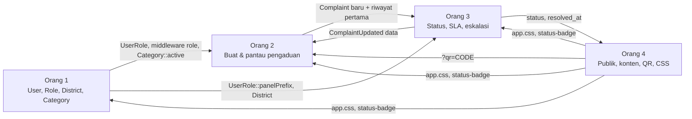

# 12. Pembagian Fitur untuk 4 Orang

Setiap orang memegang sekumpulan fitur. "Memegang" artinya: paham dan bertanggung jawab atas **route, controller, validasi, policy, logika model, tabel, view, dan tes** fitur itu. Perbaikan bug dan pengembangan di fitur itu dikerjakan pemegangnya.

| Orang | Area | Fitur |
| --- | --- | --- |
| **Orang 1** | Autentikasi & Manajemen Pengguna | F1.1 Registrasi · F1.2 Login/Logout · F1.3 Kontrol akses peran · F1.4 Kelola petugas · F1.5 Kelola kategori · F1.6 Data kecamatan & seeder |
| **Orang 2** | Pengaduan Warga | F2.1 Buat pengaduan · F2.2 Kode tiket & SLA awal · F2.3 Daftar & detail pengaduan saya · F2.4 Batalkan · F2.5 Penilaian · F2.6 Dashboard & notifikasi warga |
| **Orang 3** | Penanganan Pengaduan (Workflow Petugas) | F3.1 Antrian & filter · F3.2 Detail admin · F3.3 Ubah status · F3.4 Disposisi · F3.5 SLA & eskalasi otomatis · F3.6 Halaman eskalasi · F3.7 Dashboard KPI |
| **Orang 4** | Layanan Publik, Konten & QR | F4.1 Beranda & statistik · F4.2 Lacak tiket · F4.3 Peta publik · F4.4 Pengumuman · F4.5 FAQ · F4.6 Titik QR · F4.7 Layout & design system |

Cara membaca setiap fitur di bawah:

- **Endpoint**: method, URL, nama route.
- **Kode**: urutan file yang dilewati request.
- **Alur**: apa yang terjadi, langkah demi langkah.
- **Tabel**: tabel/kolom yang dibaca (R) atau ditulis (W).
- **Aturan**: validasi dan hak akses yang wajib dijaga.
- **Tes**: tes yang membuktikan fitur bekerja. Wajib tetap hijau.

---

## Orang 1 — Autentikasi & Manajemen Pengguna

Bab rujukan: [3](03-database-dan-model.md), [6.1–6.2](06-fitur-warga.md#61-mendaftar), [7.10–7.11](07-fitur-petugas.md#710-kategori-kabupaten), [8](08-keamanan-hak-akses.md).

### F1.1 Registrasi warga

| | |
| --- | --- |
| **Endpoint** | `GET /register` (`register`), `POST /register` (`register.store`, `throttle:5,1`, middleware `guest`) |
| **Kode** | `RegisteredUserController@create/store` → `StoreUserRequest` → `User::create` → `Auth::login` |
| **Tabel** | W `users` (`name`, `email`, `phone`, `password`, `role`) |
| **View** | `auth/register.blade.php` |
| **Tes** | `AuthenticationTest::test_public_registration_always_creates_a_citizen` |

**Alur:** validasi → ambil `name, email, password, phone` dengan `$request->safe()->only()` → `role` di-*hardcode* `UserRole::Masyarakat` → password di-hash otomatis oleh cast `hashed` → login → redirect `dashboard`.

**Aturan:** email `unique`; phone regex `^(08|\+628)[0-9]{8,12}$`; password `confirmed`, min 8, huruf + angka. **Input `role` tidak boleh pernah dibaca dari request.**

### F1.2 Login / Logout

| | |
| --- | --- |
| **Endpoint** | `GET /login` (`login`), `POST /login` (`login.store`, `throttle:5,1`), `POST /logout` (`logout`, middleware `auth`) |
| **Kode** | `AuthenticatedSessionController@create/store/destroy` → `LoginRequest` → `Auth::attempt` → `UserRole::homeRoute()` |
| **Tabel** | R `users` · W `users.last_login_at`, `sessions` |
| **View** | `auth/login.blade.php` (tabel akun demo hanya saat `app()->isLocal()`) |
| **Tes** | `test_each_role_lands_on_its_own_home_after_login`, `test_inactive_account_cannot_log_in` |

**Alur login:** `Auth::attempt([email, password, 'is_active' => true], remember)` → gagal: `ValidationException` pesan umum → berhasil: `session()->regenerate()` → `forceFill(['last_login_at' => now()])` → `redirect()->intended(route($user->role->homeRoute()))`.

**Alur logout:** `Auth::logout()` → `session()->invalidate()` → `regenerateToken()` → redirect `beranda`.

**Redirect per peran** (`app/Enums/UserRole.php`):

| Peran | `homeRoute()` | `panelPrefix()` |
| --- | --- | --- |
| `masyarakat` | `dashboard` | `null` |
| `admin_kecamatan` | `kecamatan.dashboard` | `kecamatan` |
| `admin_kabupaten` | `kabupaten.dashboard` | `kabupaten` |

User yang sudah login dan membuka `/login` dialihkan oleh `redirectUsersTo` di `bootstrap/app.php:20`.

### F1.3 Kontrol akses peran

| | |
| --- | --- |
| **Kode** | `app/Http/Middleware/EnsureUserHasRole.php`, alias `role` di `bootstrap/app.php`, grup route di `routes/web.php` |
| **Tes** | `test_citizen_cannot_open_admin_panel`, `AdminComplaintAccessTest::test_district_officer_cannot_open_regency_only_pages` |

**Alur:** `handle(Request $request, Closure $next, string ...$roles)` menerima daftar peran dari `role:a,b` → ubah ke enum `UserRole::from($role)` → user `null` atau `role` tidak ada di daftar (`in_array(..., true)`) → `abort(403)`.

**Peta grup route:**

| Grup | Middleware | Prefix / nama |
| --- | --- | --- |
| Publik | — | — |
| Tamu | `guest` | — |
| Warga | `auth`, `role:masyarakat` | — |
| Kecamatan | `auth`, `role:admin_kecamatan` | `/kecamatan`, `kecamatan.` |
| Kabupaten | `auth`, `role:admin_kabupaten` | `/kabupaten`, `kabupaten.` |

**Batas tanggung jawab:** Orang 1 menjaga lapis *peran* (boleh masuk area atau tidak). Lapis *data* (boleh menyentuh pengaduan ini atau tidak) ada di `ComplaintPolicy`, dipegang Orang 2 dan 3.

### F1.4 Kelola akun petugas (kabupaten)

| | |
| --- | --- |
| **Endpoint** | `GET/POST /kabupaten/petugas`, `PUT/PATCH /kabupaten/petugas/{officer}` (`kabupaten.petugas.*`) |
| **Kode** | `Admin\OfficerController@index/store/update` → `StoreOfficerRequest` / `UpdateOfficerRequest` |
| **Tabel** | R/W `users` (`role`, `district_id`, `is_active`) · R `districts` |
| **View** | `admin/officers/index.blade.php` |
| **Tes** | `MasterDataTest::test_regency_creates_district_officer`, `test_officer_can_be_deactivated_but_admin_cannot_deactivate_self`, `test_citizen_account_cannot_be_edited_from_officer_page` |

**Alur store:** validasi (`name`, `email` unik, `phone`, `district_id` wajib, `password`) → `User::create([... , 'role' => AdminKecamatan, 'email_verified_at' => now()])`.

**Alur update:** `abort_if(role === Masyarakat, 404)` → buang `password` kalau kosong (`array_filter`) → `update`.

**Aturan `UpdateOfficerRequest`:**
- `district_id`: `requiredIf` admin kecamatan, `prohibitedIf` admin kabupaten.
- `is_active`: `prohibitedIf` user mengubah dirinya sendiri menjadi nonaktif.
- `email` unik `ignore($officer)`.
- Tidak ada `destroy`. Petugas hanya dinonaktifkan (FK `restrictOnDelete` di riwayat).

### F1.5 Kelola kategori (kabupaten)

| | |
| --- | --- |
| **Endpoint** | `GET/POST /kabupaten/kategori`, `PUT/PATCH /kabupaten/kategori/{category}` (`kabupaten.kategori.*`) |
| **Kode** | `Admin\CategoryController` → `StoreCategoryRequest` / `UpdateCategoryRequest` (extends Store) |
| **Tabel** | R/W `categories` · R `complaints` (`withCount`) |
| **View** | `admin/categories/index.blade.php`, `_fields.blade.php` |
| **Tes** | `test_regency_creates_and_deactivates_category`, `test_duplicate_category_name_is_rejected` |

**Alur:** `prepareForValidation()` membuat `slug = Str::slug(name)` → validasi `slug` unik (`ignore` saat update) → simpan.

**Aturan:** `icon` regex `^[a-z0-9-]+$`; tidak ada `destroy`; kategori nonaktif tidak muncul di `Category::active()` (dipakai form F2.1).

### F1.6 Data kecamatan & seeder

| | |
| --- | --- |
| **Kode** | `District` model, `DistrictSeeder` (31 kecamatan, `updateOrCreate`), `CategorySeeder`, `DatabaseSeeder`, semua factory user |
| **Tabel** | W `districts`, `categories`, `users` (akun demo) |
| **Tes** | `ExampleTest::test_demo_seeder_builds_a_usable_dataset` |

**Akun demo** (`password`): `kabupaten@wadulin.test`, `patrang@wadulin.test`, `warga@wadulin.test`. Factory state: `User::factory()->adminKecamatan($district)`, `->adminKabupaten()`.

**Kontrak ke orang lain:** `District` dan `Category` dipakai semua modul. Mengubah kolomnya harus diumumkan.

---

## Orang 2 — Pengaduan Warga

Bab rujukan: [3](03-database-dan-model.md), [4.1–4.3](04-status-sla-eskalasi.md), [6](06-fitur-warga.md).

Semua endpoint di grup `auth` + `role:masyarakat`. Route model binding `{complaint}` memakai `ticket_code` (`Complaint::getRouteKeyName()`).

### F2.1 Buat pengaduan

| | |
| --- | --- |
| **Endpoint** | `GET /pengaduan/buat` (`pengaduan.create`), `POST /pengaduan` (`pengaduan.store`, `throttle:5,60`) |
| **Kode** | `ComplaintController@create` (`:38`) / `@store` (`:49`) → `StoreComplaintRequest` → `DB::transaction` |
| **Tabel** | R `categories` (aktif), `districts`, `qr_locations` · W `complaints`, `complaint_status_histories`, `complaint_attachments` · W file `storage/app/public/complaints/{ticket}/` |
| **View** | `complaints/create.blade.php` (Leaflet + `navigator.geolocation`) |
| **Tes** | `ComplaintSubmissionTest::test_citizen_submits_complaint_with_ticket_sla_and_photo`, `test_complaint_requires_a_photo_and_location_inside_jember`, `test_guest_is_sent_to_login_before_reporting`, `test_scanned_qr_prefills_the_form_and_is_linked_to_the_complaint` |

**Alur create:** baca `?qr=` → kalau ada, cari `QrLocation::active()->where('code', ...)` → kirim ke view sebagai nilai awal `latitude`, `longitude`, `district_id`, `address`, `qr_location_id`.

**Alur store (dalam satu transaksi):**
1. `Complaint::create([...validated kecuali photos, ticket_code, user_id, status=Pending, due_at])`
2. `statusHistories()->create([from_status => null, to_status => Pending])`
3. Untuk setiap foto: `store('complaints/{ticket}', 'public')` → `attachments()->create([type => Bukti, ...])`
4. Redirect `pengaduan.show` + flash.

**Aturan validasi:**

| Field | Aturan |
| --- | --- |
| `category_id` | `exists` + `is_active = true` |
| `district_id` | `exists` |
| `title` / `description` | 10–150 / 20–2000 karakter |
| `latitude` / `longitude` | `between:-8.60,-7.90` / `between:113.20,114.10` |
| `qr_location_id` | nullable, `exists` + aktif |
| `photos` / `photos.*` | wajib 1–3 / `image`, `mimes:jpg,jpeg,png,webp`, `max:2048` |

### F2.2 Kode tiket & SLA awal

| | |
| --- | --- |
| **Kode** | `Complaint::nextTicketCode()` (`:153`), `Complaint::calculateDueAt()` (`:170`), `config/wadulin.php` |
| **Tabel** | R `complaints.ticket_code` (`withTrashed`) · W `ticket_code`, `due_at` |

**Format:** `WDL-{tahun}-{6 digit}`, reset tiap tahun. Ambil `ticket_code` terbesar dengan prefix tahun ini → `+1` → `str_pad`.

**SLA:** `now()->copy()->addWeekdays(config('wadulin.sla_working_days'))`, env `WADULIN_SLA_WORKING_DAYS` (default 3).

**Masalah terbuka:** *race condition* saat dua request bersamaan → `UNIQUE constraint` gagal. Tugas perbaikan ada di Orang 2.

**Kontrak ke Orang 3:** `calculateDueAt()` juga dipanggil `disposeTo()`. Ubah tanda tangannya = beri tahu Orang 3.

### F2.3 Daftar & detail pengaduan saya

| | |
| --- | --- |
| **Endpoint** | `GET /pengaduan` (`pengaduan.index`, `?status=`), `GET /pengaduan/{complaint}` (`pengaduan.show`) |
| **Kode** | `ComplaintController@index` (`:20`) / `@show` (`:86`) → `Gate::authorize('view')` → `ComplaintPolicy::view()` |
| **Tabel** | R `complaints`, `complaint_status_histories` (**hanya `is_public = true`**), `complaint_dispositions`, `complaint_attachments` |
| **View** | `complaints/index.blade.php`, `complaints/show.blade.php`, `complaints/_card.blade.php` |
| **Tes** | `test_citizen_cannot_view_another_citizens_complaint` |

**Index:** `$user->complaints()->with(['category','district'])->when(ComplaintStatus::tryFrom($status))->latest()->paginate(10)->withQueryString()`.

**Show:** timeline = `statusHistories` publik + `dispositions`, digabung `concat()->sortBy('at')`. Kotak aksi muncul via `@can('cancel')` dan `@can('rate')`.

### F2.4 Batalkan pengaduan

| | |
| --- | --- |
| **Endpoint** | `PATCH /pengaduan/{complaint}/batal` (`pengaduan.cancel`) |
| **Kode** | `ComplaintCancellationController` → `CancelComplaintRequest::authorize()` → `ComplaintPolicy::cancel()` (`:45`) → `Complaint::cancelBy()` (`:190`) → `recordStatusChange()` |
| **Tabel** | W `complaints.status`, `resolved_at`, `escalated_at = null` · W `complaint_status_histories` |
| **Tes** | `test_reporter_can_cancel_pending_complaint`, `test_complaint_in_progress_or_owned_by_someone_else_cannot_be_cancelled` |

**Aturan:** pemilik (`user_id`) **dan** status `Pending`. `reason` nullable, maks 500, disimpan sebagai `note` publik. `cancelBy()` melempar `InvalidArgumentException` kalau status bukan Pending (pengaman kedua setelah policy).

### F2.5 Penilaian

| | |
| --- | --- |
| **Endpoint** | `POST /pengaduan/{complaint}/penilaian` (`pengaduan.rating`) |
| **Kode** | `ComplaintRatingController` → `StoreComplaintRatingRequest` → `ComplaintPolicy::rate()` (`:54`) → `$complaint->update($request->validated())` |
| **Tabel** | W `complaints.rating`, `feedback` |
| **Tes** | `test_reporter_rates_finished_complaint_only_once`, `test_unfinished_complaint_cannot_be_rated` |

**Aturan:** pemilik + status `Selesai` + `rating === null` (sekali saja). `rating` integer 1–5, `feedback` maks 1000.

**Kontrak ke Orang 3:** `rating` dibaca KPI "Rating rata-rata" di F3.7.

### F2.6 Dashboard & notifikasi warga

| | |
| --- | --- |
| **Endpoint** | `GET /dashboard` (`dashboard`), `POST /notifikasi/baca` (`notifikasi.read`) |
| **Kode** | `DashboardController`, `ReadNotificationsController` |
| **Tabel** | R `complaints` (group by status) · R/W `notifications.read_at` |
| **View** | `dashboard.blade.php` |
| **Tes** | `ComplaintStatusUpdateTest::test_reporter_sees_notification_on_dashboard_and_can_mark_it_read` |

**Dashboard:** `statusCounts` (`toBase()->selectRaw('status, count(*)')->groupBy('status')->pluck`), 5 pengaduan terbaru, 5 notifikasi terbaru, `unreadNotifications()->count()`.

**Tandai dibaca:** `unreadNotifications()->update(['read_at' => now()])` → `back()`.

**Batas tanggung jawab:** Orang 2 **menampilkan** notifikasi. Yang **mengirim** (`ComplaintUpdated`) adalah Orang 3. Format `data` notifikasi (`ticket_code`, `title`, `status`, `message`) adalah kontrak di antara keduanya.

---

## Orang 3 — Penanganan Pengaduan (Workflow Petugas)

Bab rujukan: [3](03-database-dan-model.md), [4](04-status-sla-eskalasi.md), [7.1–7.8](07-fitur-petugas.md).

Semua endpoint ada di `$adminComplaintRoutes` (dipasang di `/kecamatan` dan `/kabupaten`). View memakai `auth()->user()->role->panelPrefix()` untuk membuat nama route.

### F3.1 Antrian & filter

| | |
| --- | --- |
| **Endpoint** | `GET /{panel}/pengaduan` (`{panel}.pengaduan.index`) |
| **Kode** | `Admin\ComplaintController@index` (`:16`) → `Complaint::visibleTo($user)` (`:126`) |
| **Tabel** | R `complaints` + `category`, `district`, `user` |
| **View** | `admin/complaints/index.blade.php` |
| **Tes** | `AdminComplaintAccessTest::test_district_officer_only_sees_own_district_queue`, `test_regency_officer_sees_every_complaint` |

**Query string:**

| Param | SQL |
| --- | --- |
| `status` | `where status = ?` (via `ComplaintStatus::tryFrom`) |
| `kategori` | `where category_id = ?` |
| `kecamatan` | `where district_id = ?` — **hanya kabupaten**, kecamatan diabaikan |
| `sla=lewat` | `->overdue()` |
| `sla=24jam` | status terbuka + `due_at between now and now+1day` |
| `q` | `where (ticket_code like ? or title like ?)` — **wajib dibungkus closure** |

`paginate(15)->withQueryString()`. Jumlah per tab status: query `groupBy` terpisah dengan `visibleTo`.

### F3.2 Detail pengaduan admin

| | |
| --- | --- |
| **Endpoint** | `GET /{panel}/pengaduan/{complaint}` (`{panel}.pengaduan.show`) |
| **Kode** | `Admin\ComplaintController@show` (`:64`) → `Gate::authorize('view')` |
| **Tabel** | R semua relasi: `user`, `qrLocation`, `attachments`, `statusHistories.changer.district`, `dispositions.{fromDistrict,toDistrict,mover}` |
| **View** | `admin/complaints/show.blade.php` (Leaflet lokasi, timeline lengkap termasuk catatan internal) |

**Hak lihat (`ComplaintPolicy::view`):** kecamatan → `district_id` sama; kabupaten → semua. Panel menghitung `$canUpdateStatus`, `$canDispose`, `$transitions = status->officerTransitions()` sekali di atas view.

### F3.3 Ubah status

| | |
| --- | --- |
| **Endpoint** | `PATCH /{panel}/pengaduan/{complaint}/status` (`{panel}.pengaduan.status`) |
| **Kode** | `Admin\ComplaintStatusController` → `UpdateComplaintStatusRequest` → `ComplaintPolicy::updateStatus()` → `Complaint::transitionTo()` (`:178`) → `recordStatusChange()` (`:202`) → `ComplaintUpdated` |
| **Tabel** | W `complaints.status`, `resolved_at`, `escalated_at` · W `complaint_status_histories` · W `complaint_attachments` (type `hasil`) · W `notifications` |
| **Tes** | Seluruh `ComplaintStatusUpdateTest` (7 tes) |

**State machine** (`ComplaintStatus::officerTransitions()`, `app/Enums/ComplaintStatus.php:37`):

| Dari | Ke |
| --- | --- |
| `pending` | `diproses`, `ditolak` |
| `diproses` | `selesai`, `ditolak` |
| final (`selesai`, `ditolak`, `dibatalkan`) | — |

**Alur:**
1. `authorize()`: `updateStatus` → belum final **dan** (kecamatan: `district_id` sama | kabupaten: `isEscalated()`).
2. `rules()`: `status` `Rule::in(officerTransitions)`; `note` wajib min 10 kalau `ditolak`; `is_public` boolean; `photos` maks 3.
3. Transaksi: `transitionTo()` → foto hasil.
4. `recordStatusChange()`: set status; kalau final → `resolved_at = now()`, `escalated_at = null`; tulis riwayat.
5. Kirim `ComplaintUpdated` ke pelapor. Catatan ikut **hanya kalau `is_public`**.

### F3.4 Disposisi

| | |
| --- | --- |
| **Endpoint** | `POST /{panel}/pengaduan/{complaint}/disposisi` (`{panel}.pengaduan.disposisi`) |
| **Kode** | `Admin\ComplaintDispositionController` → `StoreComplaintDispositionRequest` → `ComplaintPolicy::dispose()` → `Complaint::disposeTo()` (`:229`) → `ComplaintUpdated` |
| **Tabel** | W `complaint_dispositions` · W `complaints.district_id`, `due_at`, `escalated_at = null` |
| **Tes** | Seluruh `ComplaintDispositionTest` (3 tes) |

**Aturan:**
- Policy: kecamatan → `district_id` sama **dan** `Pending`; kabupaten → `isEscalated()`.
- Validasi: `district_id` `exists` + `Rule::notIn([current])`; `reason` min 10.
- `disposeTo()` (transaksi): catat disposisi → ganti `district_id` → `due_at = calculateDueAt(now())` → `escalated_at = null`.
- Redirect: kecamatan → `kecamatan.pengaduan.index` (sudah tidak berhak melihat); kabupaten → `show`.

### F3.5 SLA & eskalasi otomatis

| | |
| --- | --- |
| **Kode** | `routes/console.php` (command `complaints:escalate` + `Schedule::...->hourly()->withoutOverlapping()`), `Complaint::scopeOverdue()` (`:140`), `isEscalated()` (`:145`), `config/wadulin.php` |
| **Tabel** | W `complaints.escalated_at` (bulk `UPDATE`) |
| **Tes** | `EscalateComplaintsCommandTest` (2 tes) |

**Query:** `Complaint::overdue()->whereNull('escalated_at')->update(['escalated_at' => now()])`.
`overdue()` = `status in (pending, diproses) and due_at < now()`.

**Siklus `escalated_at`:**

| Kejadian | Nilai |
| --- | --- |
| Command menemukan pengaduan terlambat | `now()` (sekali, tidak ditimpa) |
| Status final | `null` |
| Disposisi | `null` + SLA diulang |

**Jalankan:** `php artisan schedule:work` (dev) atau cron `* * * * * php artisan schedule:run` (server).

### F3.6 Halaman eskalasi (kabupaten)

| | |
| --- | --- |
| **Endpoint** | `GET /kabupaten/eskalasi` (`kabupaten.eskalasi`) |
| **Kode** | `Admin\EscalationController` |
| **Query** | `whereNotNull('escalated_at')->whereIn('status', ComplaintStatus::open())->orderBy('due_at')->paginate(20)` |
| **View** | `admin/escalations/index.blade.php`, komponen `x-sla-chip` |

### F3.7 Dashboard KPI

| | |
| --- | --- |
| **Endpoint** | `GET /kecamatan` (`kecamatan.dashboard`), `GET /kabupaten` (`kabupaten.dashboard`) |
| **Kode** | `Admin\DashboardController`, `districtRanking()` (`:77`), `averageResolutionDays()` |
| **View** | `admin/dashboard.blade.php`, `layouts/admin.blade.php`, komponen `x-kpi-card` |
| **Tes** | `test_dashboards_render_for_both_panels` |

**KPI:** `total`, `pending`, `diproses`, selesai bulan ini, `overdue`, `eskalasi`, `rating` (avg), `rata_hari`. Semua lewat closure `$complaints = fn () => Complaint::query()->visibleTo($user)` supaya setiap hitungan mendapat query baru.

**Peringkat kecamatan (kabupaten saja):** `District::withCount(['complaints as total_count', 'complaints as selesai_count' => ..., 'complaints as overdue_count' => ...->overdue()])`.

---

## Orang 4 — Layanan Publik, Konten & QR

Bab rujukan: [5](05-fitur-publik.md), [7.7](07-fitur-petugas.md#77-titik-qr-kecamatan--kabupaten), [7.9](07-fitur-petugas.md#79-pengumuman-kabupaten), [7.12](07-fitur-petugas.md#712-faq-kabupaten), [9](09-tampilan-frontend.md).

**Aturan umum modul ini:** controller publik **tidak boleh** memuat relasi `user` dan **tidak boleh** menampilkan riwayat dengan `is_public = false`.

### F4.1 Beranda & statistik

| | |
| --- | --- |
| **Endpoint** | `GET /` (`beranda`) |
| **Kode** | `HomeController` |
| **Tabel** | R `complaints` (group by status; Selesai untuk `resolved_at`/`due_at`), `categories` (`withCount` 12 bulan), `announcements` (published, 3), `districts` (count) |
| **View** | `beranda.blade.php` |
| **Tes** | `PublicPagesTest::test_home_page_shows_real_statistics_and_latest_announcement` |

**Statistik:** total; % tepat waktu = Selesai dengan `resolved_at <= due_at`; rata-rata hari = mean(`resolved_at - created_at`)/24 jam. Nilai kosong → `—`. 6 aduan terbaru tanpa status `dibatalkan`, kolom dibatasi lewat `get([...])`.

### F4.2 Lacak tiket

| | |
| --- | --- |
| **Endpoint** | `GET /lacak?kode=` (`lacak`, `throttle:10,1`) |
| **Kode** | `TrackingController` |
| **Tabel** | R `complaints` + `category`, `district`, `statusHistories` (`is_public = true`, `oldest()`) |
| **View** | `tracking.blade.php` (3 state: kosong, tidak ditemukan, ditemukan) |
| **Tes** | `TrackingTest` (2 tes) |

**Normalisasi:** `strtoupper(trim(kode))`. Pakai GET supaya hasil bisa dibagikan sebagai link.

### F4.3 Peta publik

| | |
| --- | --- |
| **Endpoint** | `GET /peta` (`peta`) |
| **Kode** | `PublicMapController` → array marker → `@json` → Leaflet `circleMarker` |
| **Tabel** | R `complaints` status `pending/diproses/selesai`, `latest()->limit(500)` |
| **View** | `map.blade.php` |
| **Tes** | `test_public_map_lists_complaints_without_reporter_identity` |

**Payload per marker (whitelist):** `lat`, `lng`, `ticket`, `title`, `category`, `district`, `status`, `color` (`hexColor()`), `url` (ke `lacak`). Field di luar daftar ini **tidak boleh** dikirim. String dari warga wajib lewat `escape()` sebelum masuk `bindPopup`.

### F4.4 Pengumuman

| | |
| --- | --- |
| **Endpoint publik** | `GET /pengumuman` (`pengumuman.index`), `GET /pengumuman/{announcement}` (`pengumuman.show`, binding `slug`) |
| **Endpoint admin** | `GET/POST /kabupaten/pengumuman`, `PUT/PATCH /kabupaten/pengumuman/{announcement}` |
| **Kode** | `AnnouncementController`, `Admin\AnnouncementController`, `StoreAnnouncementRequest`, `UpdateAnnouncementRequest`, `Announcement::scopePublished()` |
| **Tabel** | R/W `announcements` · W file `storage/app/public/announcements/` |
| **View** | `announcements/index`, `announcements/show`, `announcements/_card`, `admin/announcements/*` |
| **Tes** | `test_only_published_announcements_are_public`, `ContentManagementTest::test_regency_publishes_announcement_with_cover`, `test_unpublishing_announcement_hides_it` |

**Aturan:**
- `slug` dibuat di `prepareForValidation()` dari `title`, `unique` + `ignore` saat update.
- `published_at` diisi saat pertama terbit, tidak diubah saat sunting.
- `show()` wajib `abort_unless(is_published && published_at->isPast(), 404)`.
- Ganti sampul → hapus file lama dari disk.
- Validasi: `title` 5–200, `body` min 20, `cover` image maks 2 MB.

### F4.5 FAQ

| | |
| --- | --- |
| **Endpoint publik** | `GET /faq` (`faq`) |
| **Endpoint admin** | `GET/POST /kabupaten/faq`, `PUT/PATCH/DELETE /kabupaten/faq/{faq}` |
| **Kode** | `FaqController`, `Admin\FaqController`, `StoreFaqRequest`, `UpdateFaqRequest`, `FaqSeeder` |
| **Tabel** | R/W `faqs` |
| **View** | `faq.blade.php` (`
`), `admin/faqs/*` |
| **Tes** | `test_faq_page_hides_unpublished_entries`, `test_regency_manages_faq` |

**Query publik:** `Faq::published()->orderBy('sort_order')->orderBy('id')`. Satu-satunya data master yang punya `destroy`.

### F4.6 Titik QR

| | |
| --- | --- |
| **Endpoint scan** | `GET /qr/{qrLocation:code}` (`qr.scan`) |
| **Endpoint admin** | `GET/POST /{panel}/qr`, `PUT/PATCH /{panel}/qr/{qrLocation}` |
| **Kode** | `QrScanController`, `Admin\QrLocationController`, `StoreQrLocationRequest`, `UpdateQrLocationRequest`, `QrLocationPolicy`, `QrLocation::generateCode()` (`:79`), `scopeManageableBy()` (`:69`) |
| **Tabel** | R/W `qr_locations` · R `complaints` (`withCount`) |
| **View** | `admin/qr-locations/index.blade.php`, `_fields.blade.php` (qrcodejs + unduh PNG via `canvas.toDataURL`) |
| **Tes** | `ComplaintSubmissionTest::test_inactive_qr_cannot_be_scanned`, `ContentManagementTest::test_district_officer_creates_qr_point_in_own_district`, `test_district_officer_cannot_edit_another_districts_qr_point`, `test_regency_must_pick_district_for_qr_point` |

**Alur scan:** cari `code` → `abort_unless(is_active, 404)` → redirect `pengaduan.create?qr={code}` (diteruskan ke F2.1 milik Orang 2).

**Alur store:** `district_id` = pilihan (kabupaten) atau `$user->district_id` (kecamatan) → `code = generateCode()` (10 char acak, cek unik) → `created_by`.

**Aturan:**
- `district_id`: `requiredIf` kabupaten, `prohibitedIf` kecamatan.
- Update: `QrLocationPolicy::update` (kabupaten semua; kecamatan miliknya) + controller membuang `district_id` untuk kecamatan.
- Koordinat dalam kotak Jember (sama dengan F2.1).

**Kontrak ke Orang 2:** parameter `?qr=` dan field yang diisi otomatis (`latitude`, `longitude`, `district_id`, `address`, `qr_location_id`).

### F4.7 Layout & design system

| | |
| --- | --- |
| **Kode** | `resources/css/app.css` (`@theme`, `@layer base`, `@layer components`), `layouts/app.blade.php`, komponen `x-status-badge`, `vite.config.js` |
| **Perintah** | `npm run dev`, `npm run build` |

**Isi:** token warna (`primary`, `accent`, `ink`, `paper`, `line`), class `container-page`, `panel`, `btn` + `btn-*`, `field-*`, `alert-*`, `ticket`, `link`; navigasi publik (`$navItems`, menu mobile `
`), footer.

**Kontrak ke semua orang:** class dan token di atas dipakai di semua view. Class/warna baru ditambahkan lewat Orang 4.

---

## Ketergantungan antar orang

## Kontrak bersama (jangan diubah sepihak)

| Kontrak | Pemilik | Dipakai oleh |
| --- | --- | --- |
| `UserRole` (nilai, `homeRoute()`, `panelPrefix()`) | Orang 1 | Semua |
| Middleware `role` + grup route | Orang 1 | Semua |
| Kolom & relasi `Complaint` | Orang 3 | 2, 4 |
| `ComplaintStatus` (nilai, `officerTransitions()`, `isFinal()`, `open()`, `hexColor()`) | Orang 3 | 2, 4 |
| `Complaint::visibleTo()`, `overdue()` | Orang 3 | 2 |
| `Complaint::calculateDueAt()`, `nextTicketCode()` | Orang 2 | 3 |
| `ComplaintPolicy` | `view`/`cancel`/`rate`: Orang 2 · `updateStatus`/`dispose`: Orang 3 | — |
| Format `data` notifikasi `ComplaintUpdated` | Orang 3 | 2 |
| Parameter `?qr=` + field prefill | Orang 4 | 2 |
| Token & class CSS, `x-status-badge` | Orang 4 | Semua |
| `DatabaseSeeder` | Orang 1 | Semua (tambah data di bagian sendiri) |

## Backlog per orang

Tugas lanjutan dari [bab 11.7](11-panduan-kerja.md#117-keterbatasan-yang-diketahui), sudah dibagi ke pemegangnya.

| Orang | Tugas |
| --- | --- |
| 1 | Reset password (`password_reset_tokens`) · Halaman profil (`address`, `avatar_path`) · Tampilkan `categories.icon` |
| 2 | Perbaiki race condition kode tiket · Pratinjau foto sebelum kirim · Pindah foto ke disk privat + controller unduh ber-policy |
| 3 | Hari libur nasional di SLA · Notifikasi ke kabupaten saat eskalasi · Ekspor antrian ke CSV · Kirim notifikasi lewat email/WA |
| 4 | Hapus pengumuman + file sampul · Bundel Leaflet & qrcodejs via npm · Filter peta per kategori/kecamatan · Cache statistik beranda · Hapus `welcome.blade.php` |

## Aturan kerja

1. Satu cabang per tugas, awali dengan nomor orang: `o2/race-ticket-code`.
2. Ubah kontrak bersama → tulis di PR siapa yang terdampak, minta review dari orang itu.
3. Sebelum PR: `vendor/bin/pint --dirty --format agent` lalu **semua** tes `php artisan test --compact`.
4. Fitur baru wajib punya tes: minimal satu kasus berhasil dan satu kasus ditolak.
5. Perbarui bab `docs/` yang membahas fitur yang diubah.

Kembali ke [daftar isi](README.md).
